# Binomial Queue(一种优先队列)

## 背景

Time of inserting N numbers into a binary tree : O(N)
这里只是二叉树，没有排序规则，直接往里插入就可以了，所以每一个的插入时间应该是O(1)，总时间为O(N)
Time of inserting N numbers into a binary heap : O(N)
因为我们先放到数组里，这是线性的，再调用build-heap函数，也是线性的

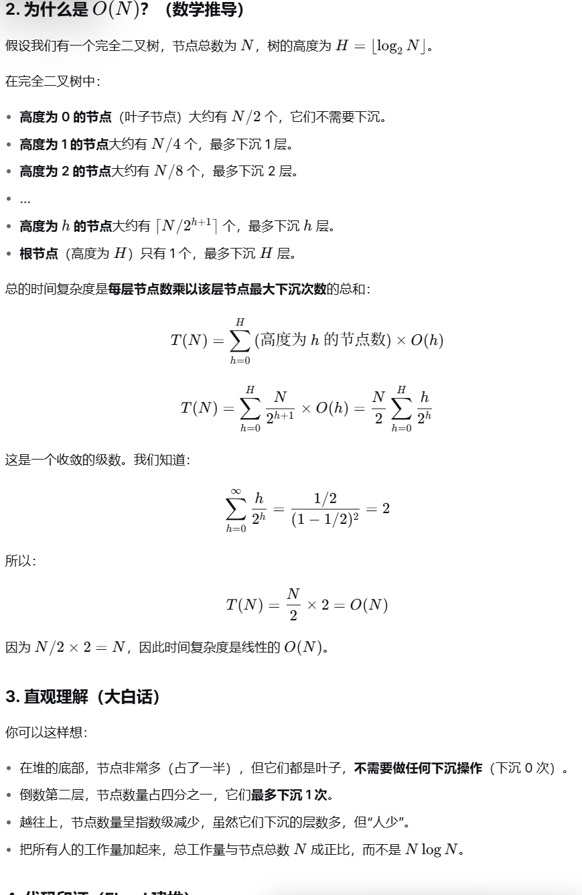

这样的话，插入的平均时间是可能到常数级别的，所以先前的左式堆的方法可能还不够好，所以要再来介绍Binomial Queue这种方法。

## Structure

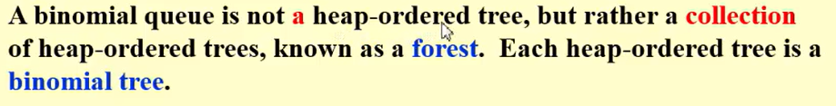

每一棵树都是二项树，满足堆有序的定义

- binomial Tree:

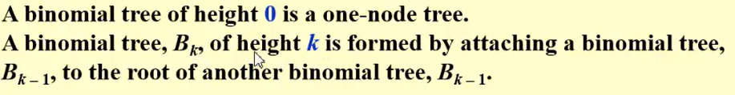

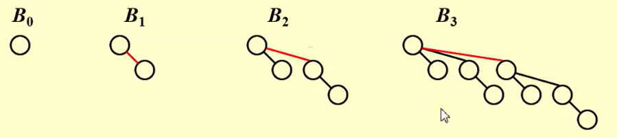

观察结果：$B_k$包括一个有K个孩子的根，k个子节点是 $B_0$到$B_{k-1}$，节点的数量是$2^k$，在depth为d的节点数量是二项式系数$\begin{bmatrix} k \\ d \end{bmatrix}$

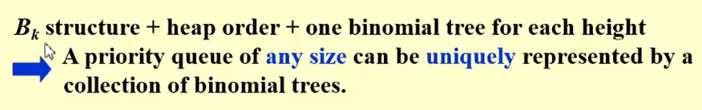

任意大小的优先队列都可以被唯一表示为一个二项树的集合

- 操作方法：

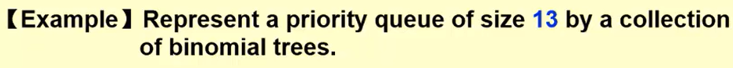

将13拆成多个2的K次方形式(将13表示为二进制即可)填充的时候让每个树都是最小堆

## Operations

### FindMin

已知根节点是每个树里面最小的，直接将每个树的根拿出来进行比较找最小的

- 时间：O(logN)
> [!NOTE]
> 但是如果我们可以用额外的空间来存最小值并一直更新的话，那么这一步操作就是O(1)，但是在删除的时候也需要调整，时间依旧是O(logN)。这样的操作就没必要了。

### Merge

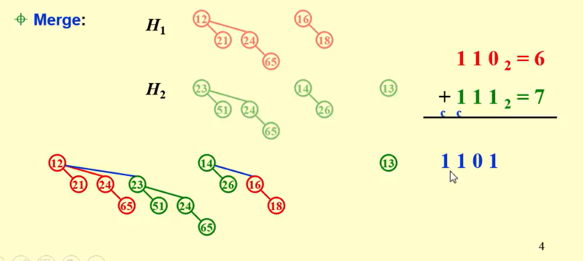

按照类似二进制加法来操作

- 时间：O(logN)。每一次合并时间是常数，一共合并logN次
最后的树的结果按高度排，这样的话在FindMin和Merge操作中都比较方便

### Insert

操作和Merge相同。
观察：


$B_0$空，就是没数，那么直接加进去，一下。如果$B_1$空，就是两个位置只有根有，加到一个空的$B_0$里面再合并，两下……

### DeleteMin

1. FindMin in $B_k$          O(logN)
2. Remove $B_k$ from H       O(1)
3. Remove root from $B_k$    O(logN) 其实就是k
4. Merge(H',H'')               O(logN)

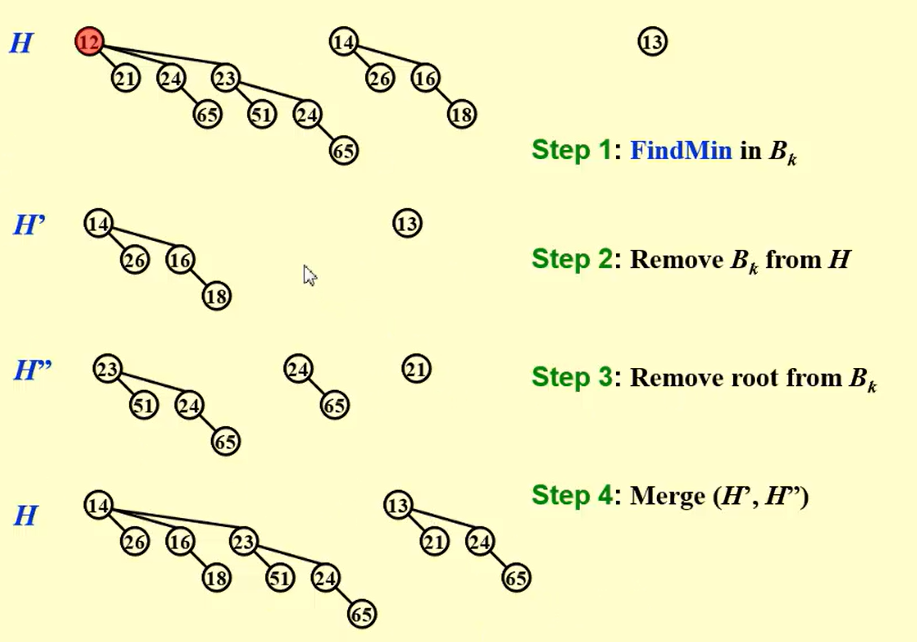

### Implementation

Binomial queue = array of binomial trees

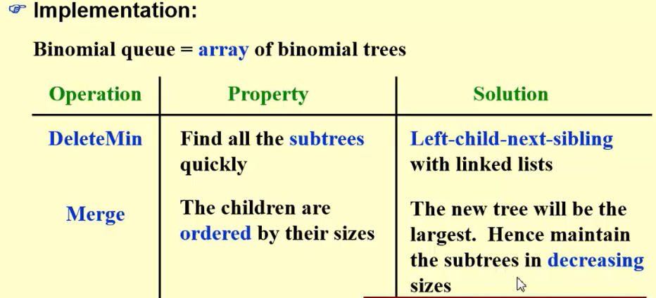

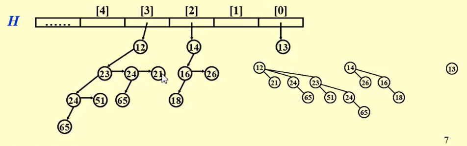

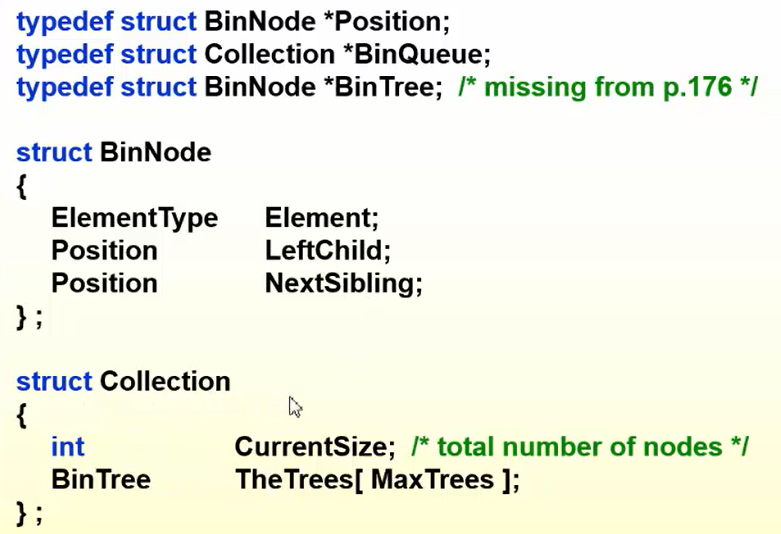

合并操作：简单 O(1)

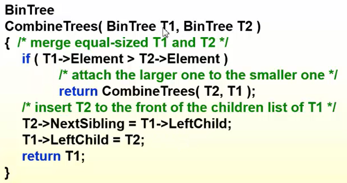

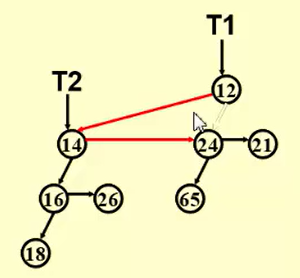

合并操作：完整

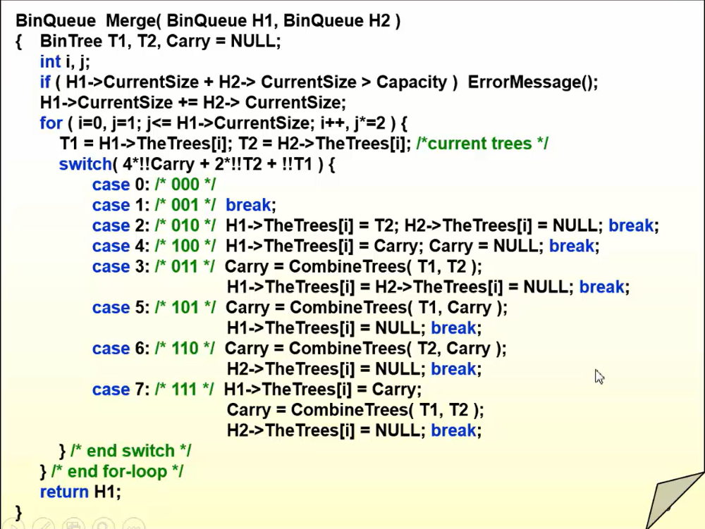

```c
for(i=0,j=1;j<=H1->CurrentSize;i++,j*=2)//此时，可以保证i是从0到logN，并且j是此时$B_i$的节点数
```

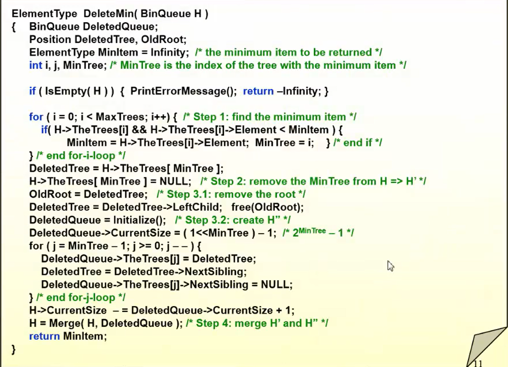

### Analysis

#### Aggregate

N次总时间是O(N)，二进制加法进位的次数是有限的，摊还时间是常数。

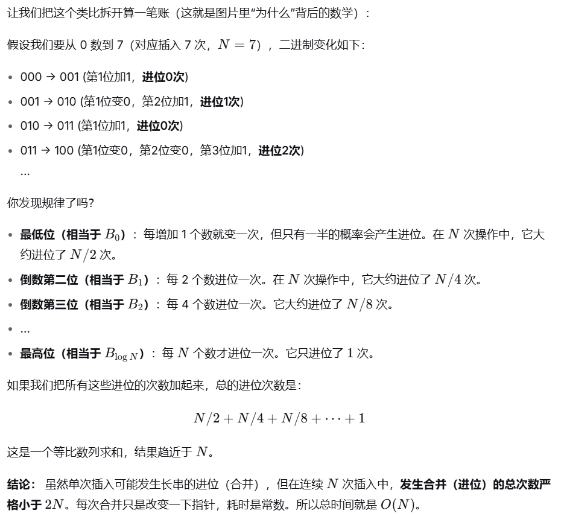

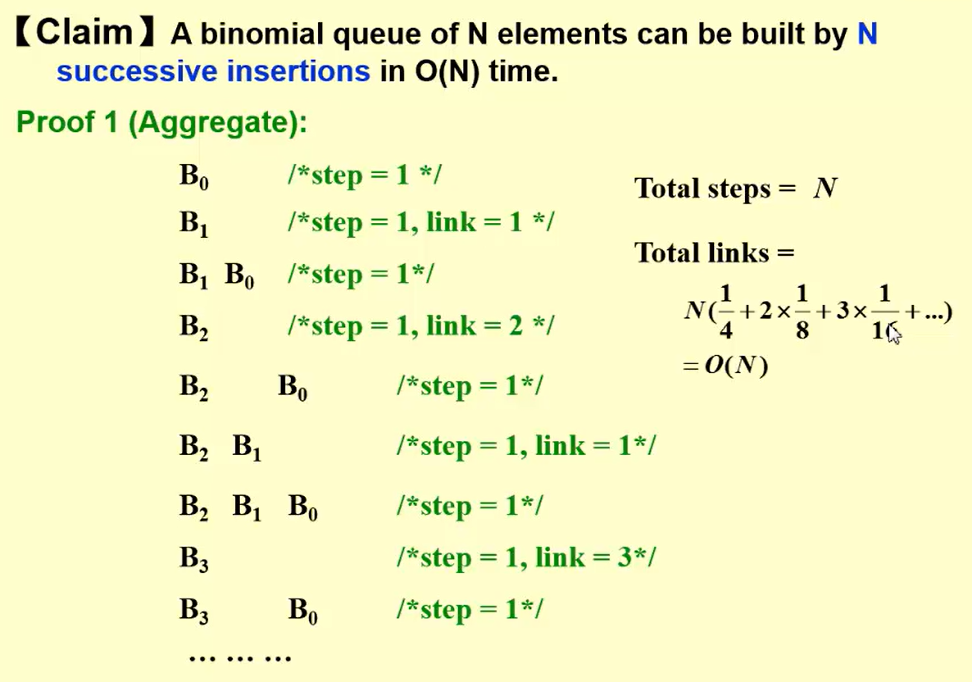

#### Potential function

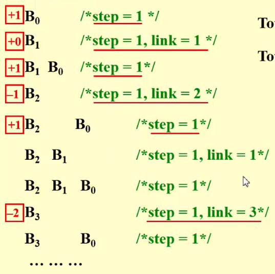

现在的总数就是树的个数

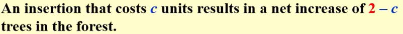

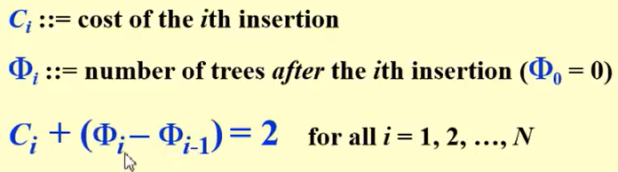

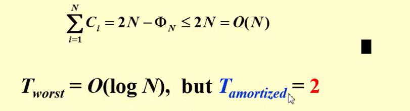
