# Dynamic Programming(动态规划)

——每种答案只查找一遍

## 思想

只访问一次就解决每个子问题，并将结果保存在table中

### 示例1：Fabonacci 数列：

初始的递归方法：

```c
int Fib(int N)
{
    if(N<=1)
    {
        return 1;
    }else{
        return Fib(N-1)+Fib(N-2);
    }
}
```

但是这种方法对应的时间会很长，

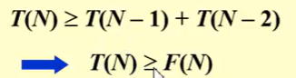，最终的时间是指数级增长的

修改：记录下来最近的两个数不去重复计算

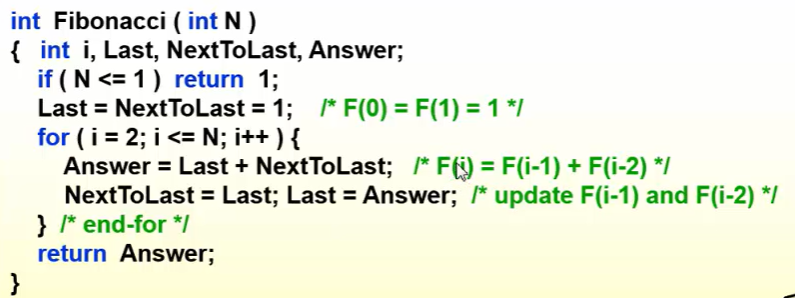

```c
int Fib(int N)
{
    int i,Last,NextToLast,Answer;
    if(N<=1)return 1;
    Last=NextToLast=1;
    for(i=2;i<-N;i++){
        Answer = Last+NextToLast;
        NextToLast=Last;
        Last = Answer;
    }
    return Answer;
}
```

此时T(N)=O(N)
`DP核心思想：从指数函数转变到线性函数`

### 示例2：Ordering Matrix Multiplications(矩阵计算)

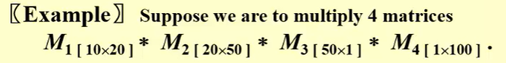

一种计算方式：

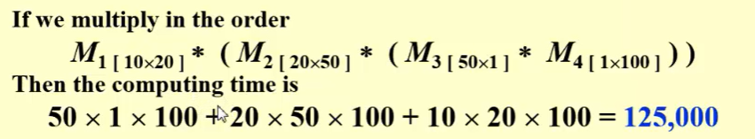

另一种计算方式：

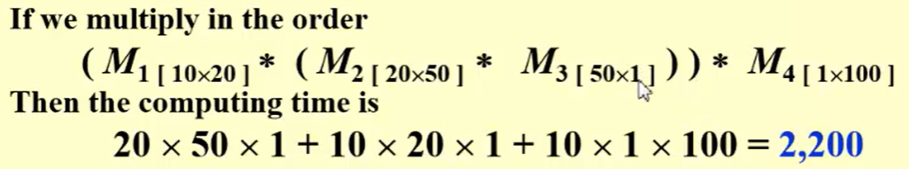

所以我们需要找到一个合适的顺序找到最小的计算顺序

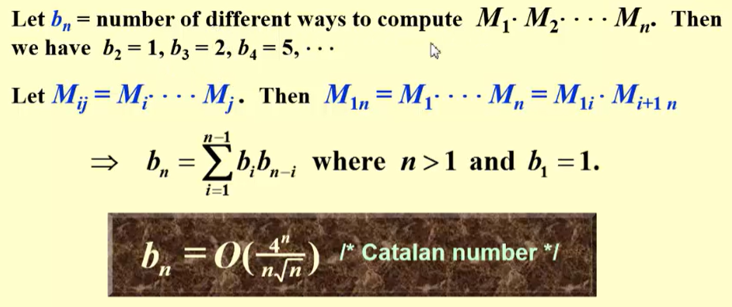

这样穷举的话内容很多没办法得到结果
所以可以考虑一下子问题：

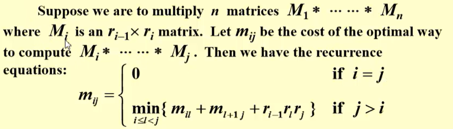

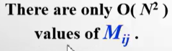

用动态规划去存储计算数据减少计算
伪代码：

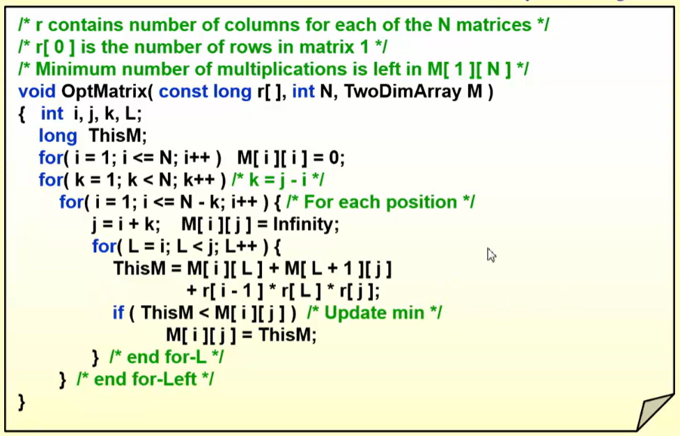

$T(N) = O(N^3)$

### 示例3：Optimal Binary Search Tree(OPST，静态搜索最好的查找方法)

`静态搜索是没有插入和删除的情况的`
二分搜索对应着一个完美的二叉搜索树

使用情形：

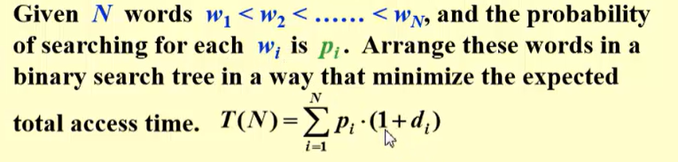

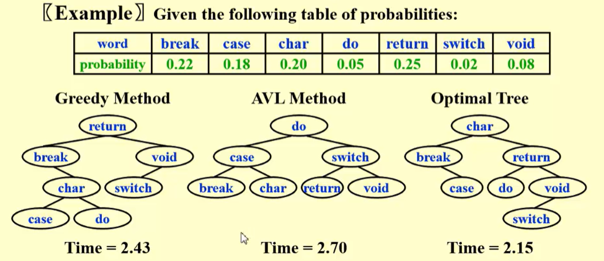

怎么得到OPST的：

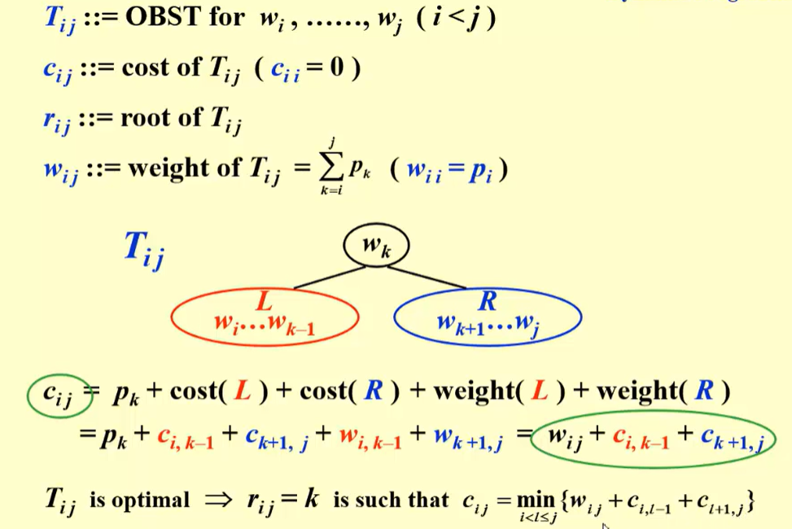

### 示例4：All-Pairs Shortest Path

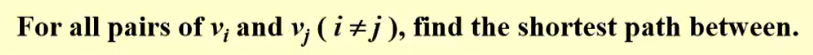

1. Use single-source algorithm for |V| times
2. 动态规划

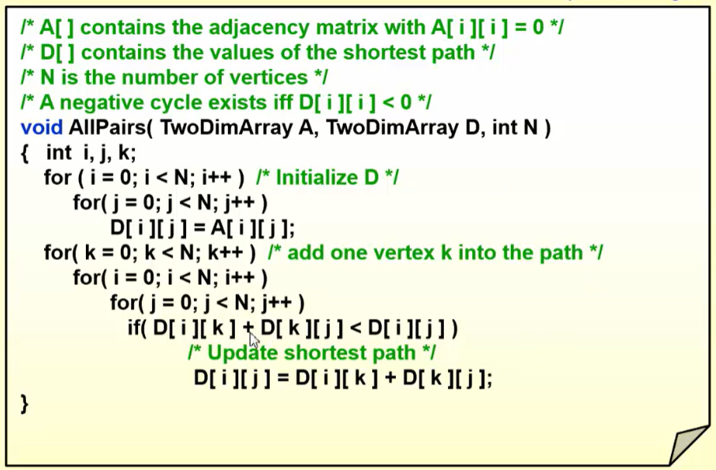

$T(N) = O(N^3)$
对于非常稠密的图速度更快

## 怎样设计一个DP方法

1. 界定最优解的特值，就是确定合适的子问题
2. 递归地定义最优值
3. 按特定顺序计算数值
4. 重构求解策略

### 示例

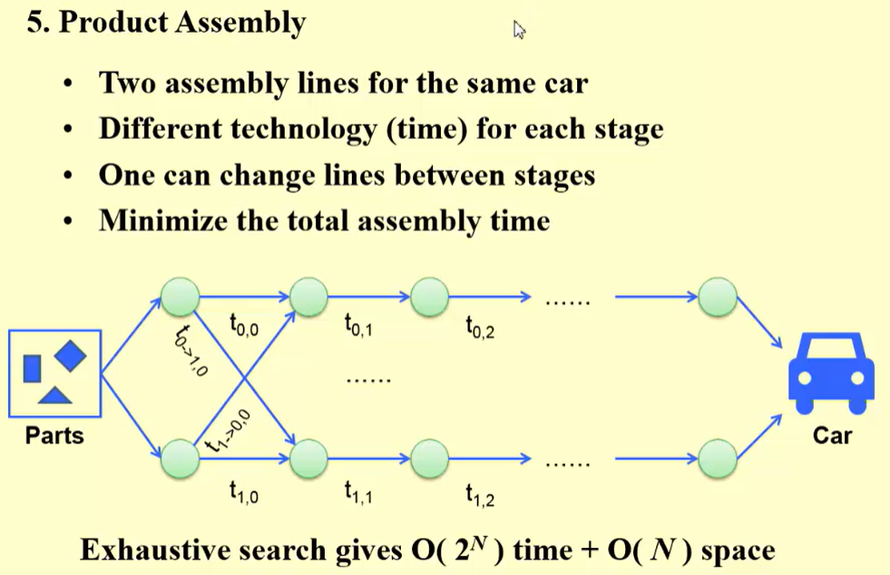

### 条目 1

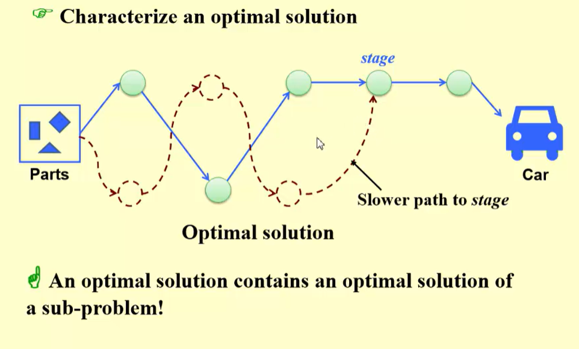

### 条目 2

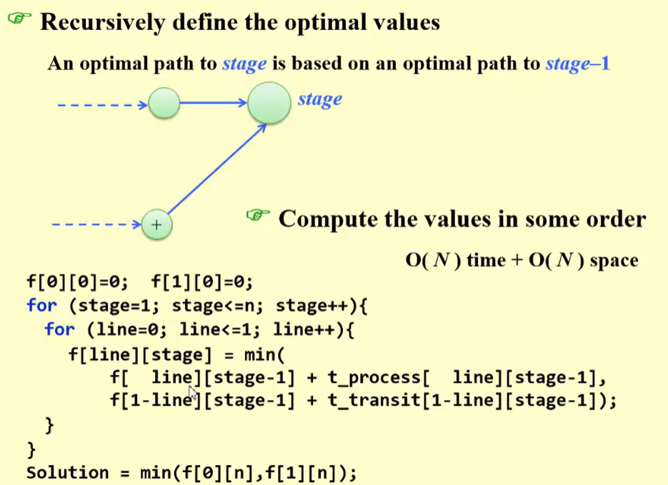

### 条目 3

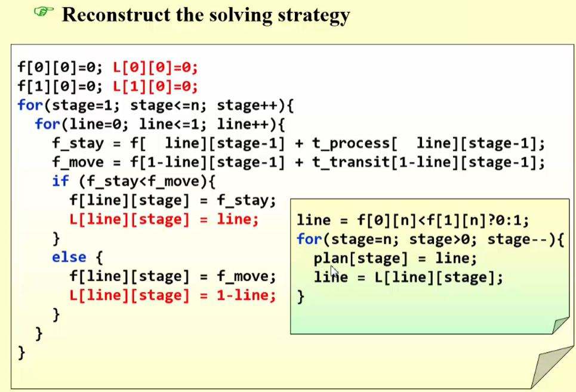

### 总结

最优子结构与重叠子问题
不满足最优子结构情况如图所示

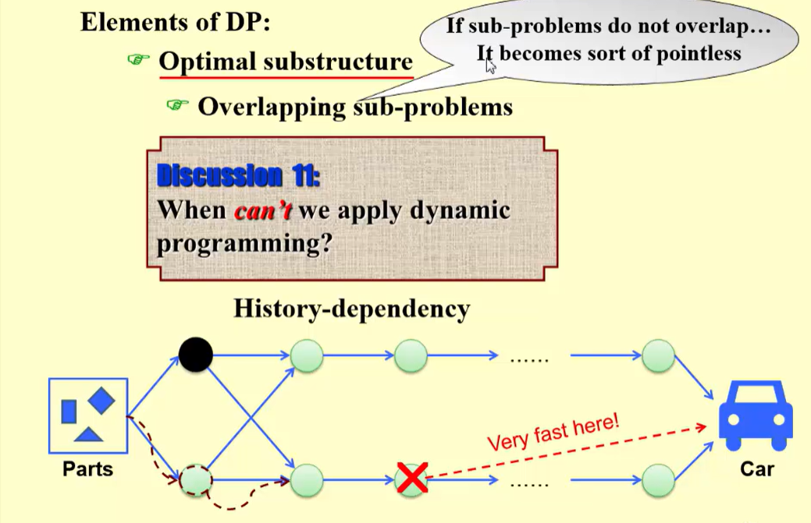

## 题目

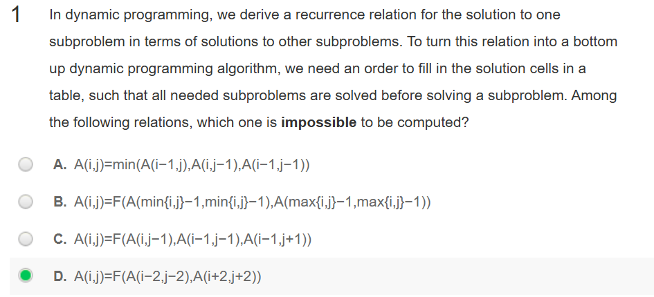

问题在于在计算A(i,j)之前，它所依赖的其他状态必须已经计算完成。

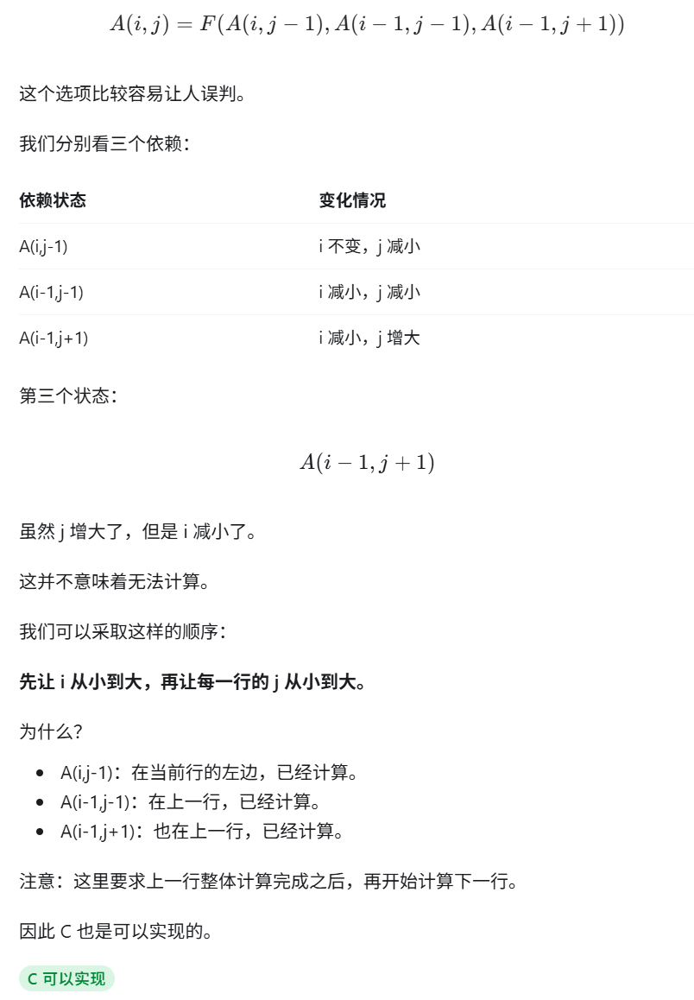

### 条目 2

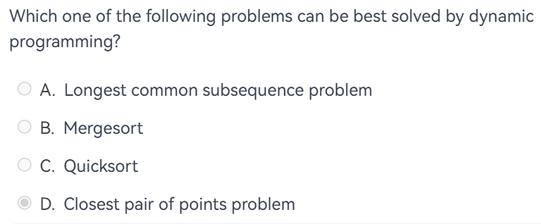

A最长公共子序列，有最优子结构和重叠子问题。
D Closest pair of points problem (最近点对问题)是分治的示例

### 条目 3

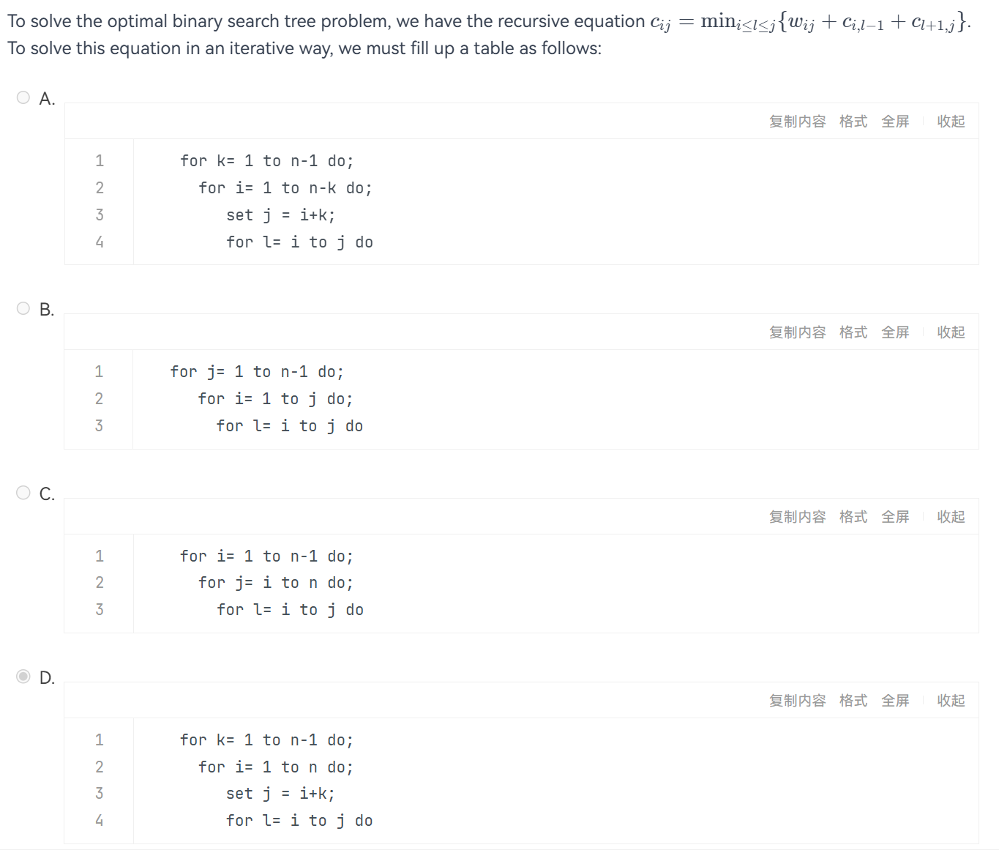

这个是OBST问题，我们需要保证的是在求Ci,j大范围的时候，i固定，j较小的和j固定,i较大的都要得到。
A k表示区间跨度k从小到大，然后先看i再看j，可以保证结果成立。并且不会超出范围。
B 我们是先把j固定所有的Ci,j求出来，现在的话就是j固定,i较大的求不出来
C 和B相似，现在是也是j固定，i较大的求不出来。因为都是从小到大算的，较大的那个一定会出问题
D 超范围了

### 条目 4

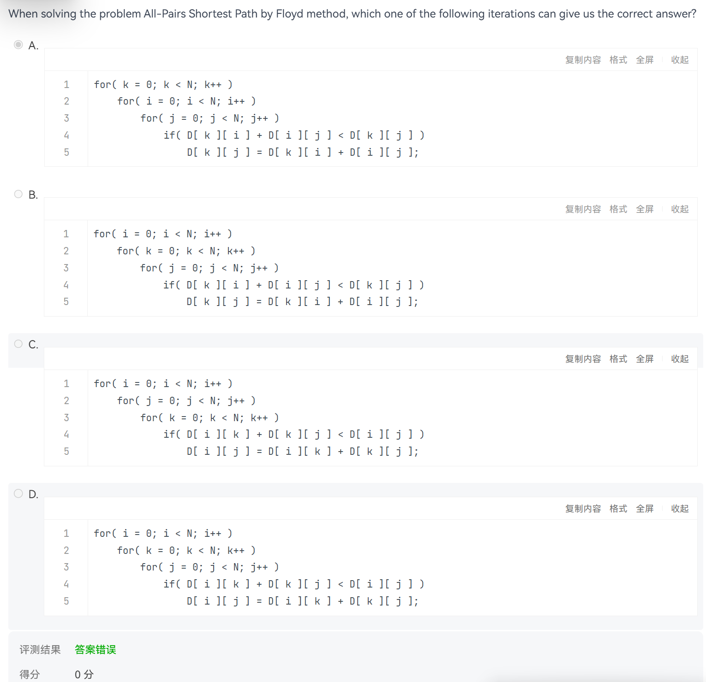

这道题和上面的意思一样，也是从长度范围开始，然后是两端的位置，要保证范围不能超
在A B里面，i是中间的范围，应该在最外面，所以第一行是i
在C D里面，k是中间的位置，应该在最外面，所以第一行是k
所以最后应该选B

### 条目 5

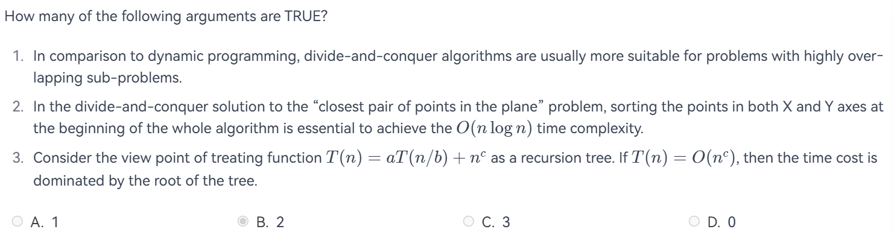

A 与动态规划相比，分治算法通常更适合处理子问题高度重叠的问题。
错误，这些是用动态规划的条件

B 在平面最近点对问题的分治解法中，算法一开始就分别按X轴和Y轴对点进行排序，对于达到O(nlogn)时间复杂度是必要的

错误，点不仅没有按照X坐标排序，也没有按照Y坐标排序，那么就不可能在 $O(N\log N)$ 时间内解决最近点对问题.

这道题有一个前提条件是在整个算法开始时，是必要的。但是实际上可以开始时先按照X排序，然后再递归划分左右子集，再在递归返回的时候分别按照Y排序合并，这样时间一样，但不一定是给出的操作。

C 从递归树的角度看$T(n) = aT(N/b) + n^c$。如果$T(n) = O(n^c)$，则时间代价由树的根节点主导
正确

### 条目 6

Suppose that a string of English letters is encoded into a string of numbers.  To be more specific, A-Z are encoded into 0-25.  Since it is not a prefix code, the decoded result may not be unique. For example, 1213407 can be decoded as BCBDEAH, MBDEAH, BCNEAH, BVDEAH or MNEAH.  Note that 07 is not 7, hence cannot be decoded as H.

The function Decode is supposed to return the number of different ways (modulo BASE to avoid overflow) we can decode NumStr, where NumStr is a string consisting of only the numbers 0-9. Please complete the following program.

```c
int Decode( char NumStr[] )
{
    int L, i;
    int dp[MAXN];//dp[i] is the solution from NumStr[i] to the end
    
    L = strlen(NumStr);
    if (L==0) return 0;
    if (L==1) return 1;
    dp[L-1] = 1;
    if (NumStr[L-2]=='1' || (NumStr[L-2]=='2' && NumStr[L-1]<'6'))
        dp[L-2] = 2; 
    else dp[L-2] = 1;
    for (i=L-3; i>=0; i--) {
        if (NumStr[i]=='1' || (NumStr[i]=='2' && NumStr[i+1]<'6'))
             dp[i] = dp[i+1]+dp[i+2];
        else dp[i] = dp[i+1];        //这里我们是找后面的，dp[L-3]要想找的话就是dp[L-2]和dp[L-1]的和或者dp[L-2]的值
        dp[i] %= BASE; //to avoid overflow
    }
    return dp[0];
}
```
