# Divide and Conquer

## Recursively

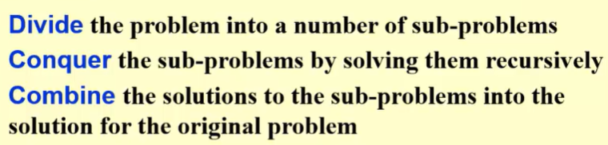

T(N) = aT(N/b) + f(N)

## Example:Closest Points Problem

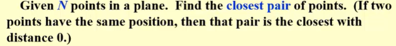

1. Exhaustive Search(穷举)

检查N(N-1)/2对，$T = O(N^2)$

2. Divide and Conquer(分治)

和最大子序列想法相同，最大子序列 T = O(N logN)
但是需要注意f(N)是什样子的，否则可能会到$T = O(N^2)$的状态

### Recall:T(N) = 2T(N/2) + cN

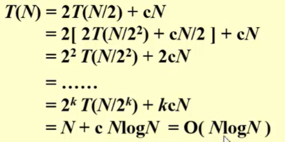

其中k = logN

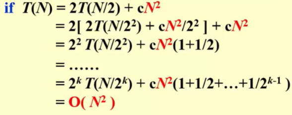

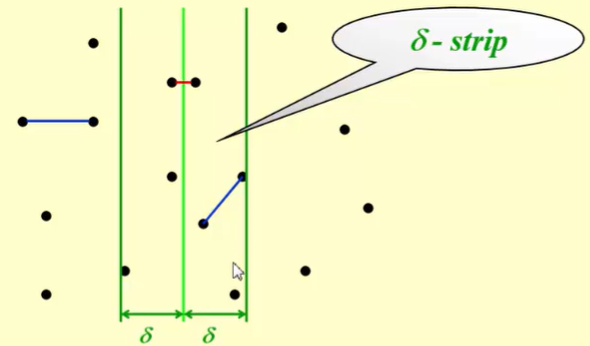

回到这道题，现在左边和右边分别找到最小的，以最小的那个距离为δ，来判断在条带里面的是否有更小的

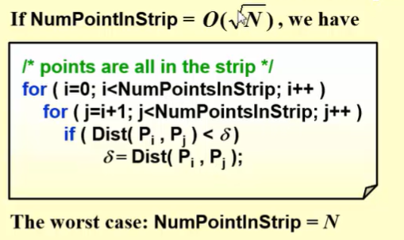

如果是根号N的话成立，不是的话不成立
竖着的分想过了，试一下竖着横着都分

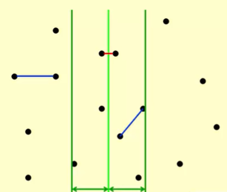

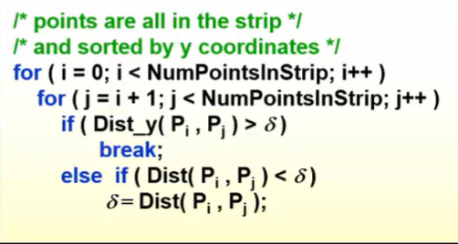

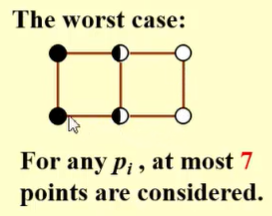

意思是将这个大矩形分成8个等大小的正方形，每个里面最多一个。因为在左半区或右半区，任意两点之间的距离都至少为δ，但是小正方形的对角线比δ小

### 计算递归方程的方法

注意事项：

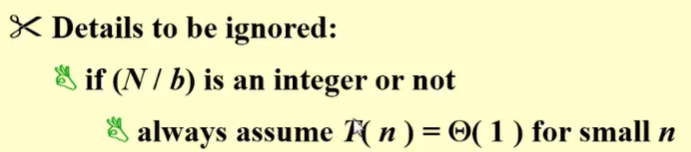

1. Substitution method

关键是在于做出一个合理的假设

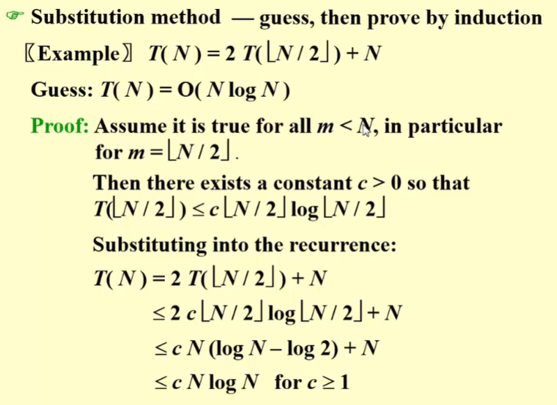

在使用归纳法的时候，对足够大的和2、3这样比较小的数字成立就可以了，不一定非要到1成立。但是证明结果的时候一定要证明的是精确格式

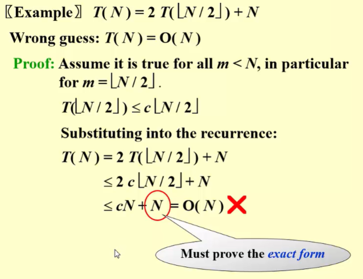

就是证明出来的结果上面是c倍的，下面是c+1倍的，这就不成立

2. Recursion-tree method

可以帮助给出良好的猜测的方法

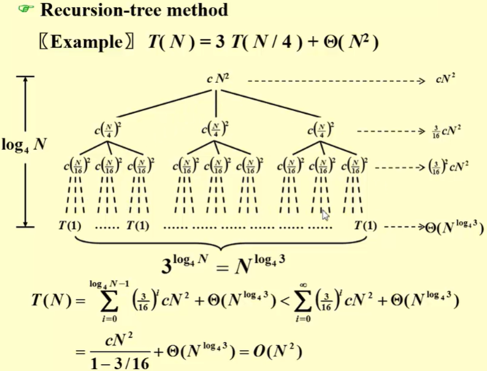

如果树不平衡，我们也可以大概得出一个比较合理的估计

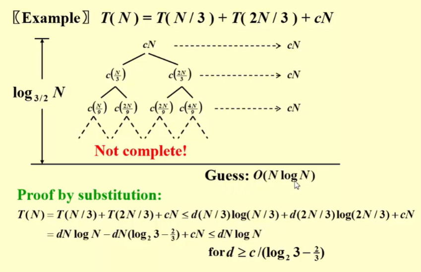

3. Master method

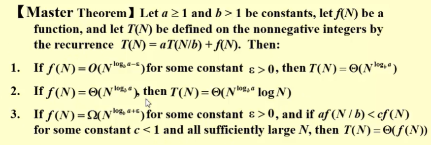

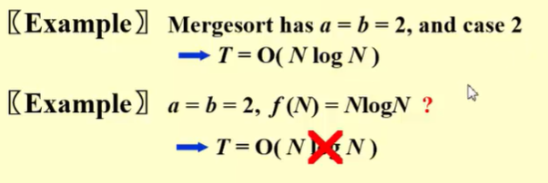

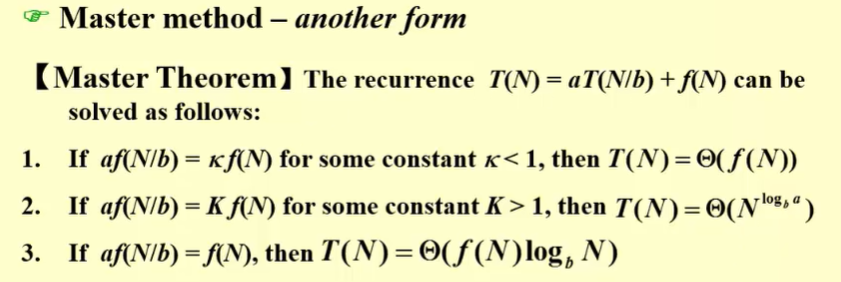

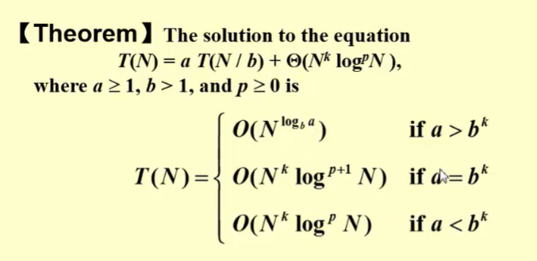

## 题目

### 条目 1

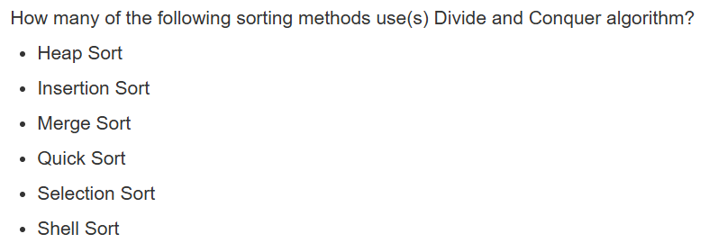

Merge Sort和Quick Sort是，Shell Sort是分组的类型，但是不是分治的算法，没有递归。

> Insertion Sort(插入排序)

从后往前扫描，到了合适的位置就插入进去。
Selection Sort(选择排序)
每次在“未排序”部分中找到最大或最小的放到已排序部分的结尾。
Shell Sort(希尔排序)
插入排序的升级版，采用分组的方法，分组进行插入排序再合并
Merge Sort(归并排序)
典型的分治法，一分为二，然后合并，采用递归的方法
Quick Sort(快速排序)
同样是分治法，分区进行快排。
Heap Sort(堆排序)
大顶堆，然后将堆顶元素与堆末尾元素交换，此时最大值就排在了正确位置。接着将剩下的元素重新调整为大顶堆，重复上述交换和调整的过程。

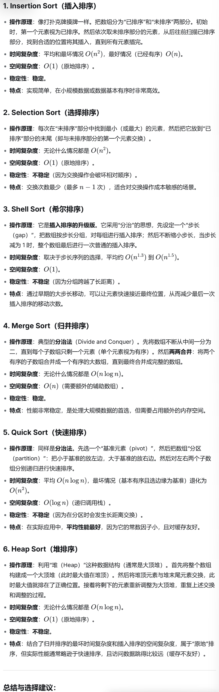

### 条目 2

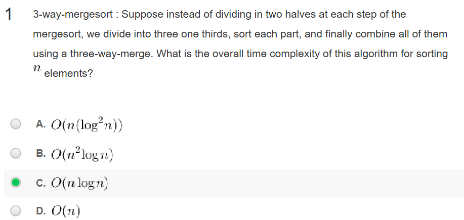

代入公式即可

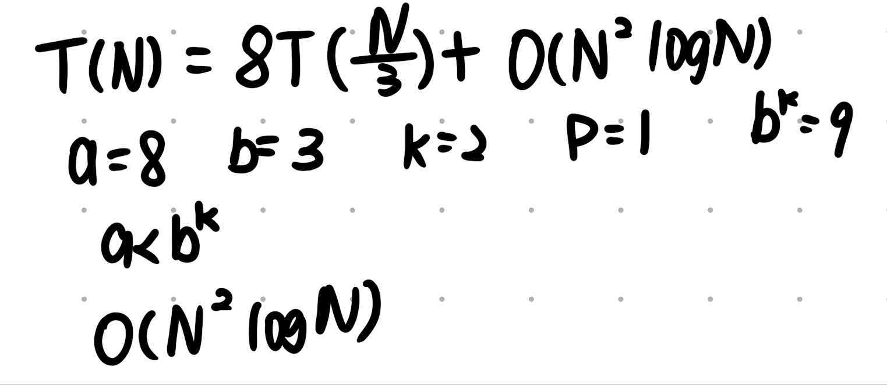

### 条目 3

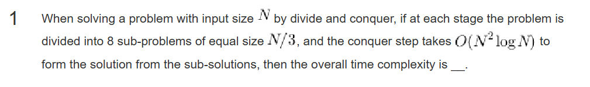

选C

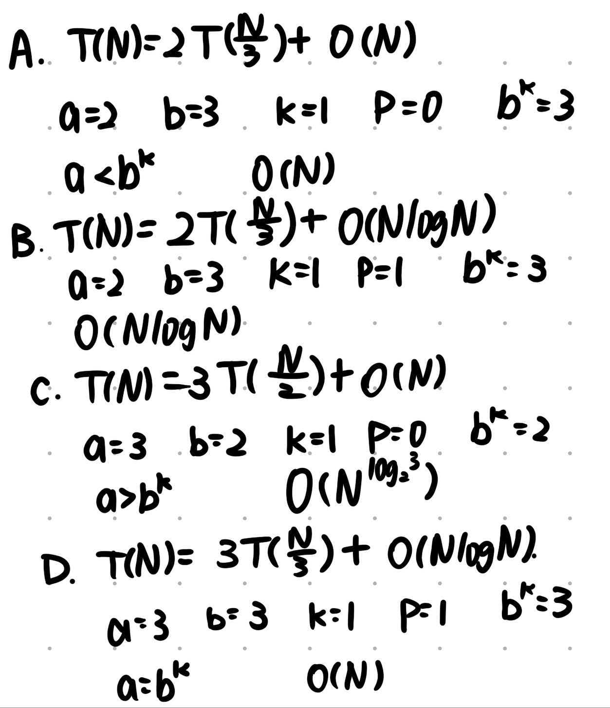

### 条目 4

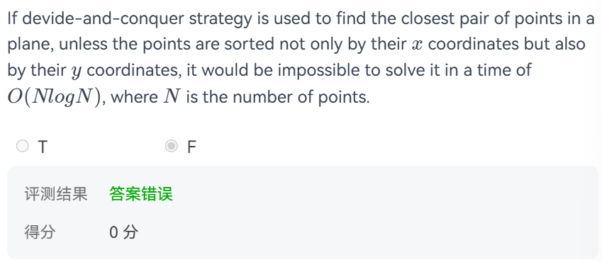

正确。
按照 $x$ 坐标排序：将所有点分为左右两部分，分别递归求出两部分的最近点对距离。
按照 $y$ 坐标排序：在合并阶段，筛选分界线附近可能存在更近点对的区域，并按照 $y$ 坐标顺序检查候选点。
合并结果：利用 $y$ 坐标的有序性，将合并阶段的时间控制在 $O(N)$。

这样时间\[T(N)=$O(N\log N)$]
按照 $y$ 坐标维护点的顺序，可以避免合并阶段重复排序，从而保证整体复杂度为 $O(N\log N)$

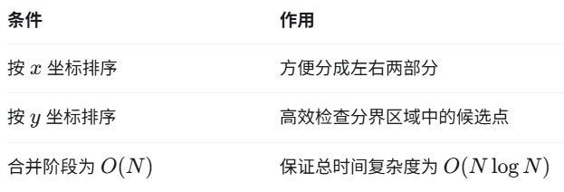

### 条目 5

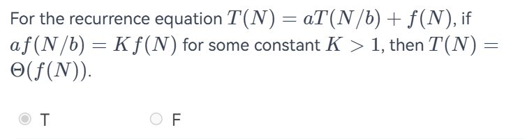

错误，见上面主定理的内容

6. 程序填空题

The function Knapsack01 is to solve the 0-1 Knapsack problem by backtracking.  The parameters are defined as the following:

- W is the capacity of the knapsack;
- n objects are stored in the array s with the following structure:

```cpp
typedef struct ObjNode *Objects;
struct ObjNode {
  double w;  /* weight */
  double p;  /* profit */
};
```

- Array x stores a feasible solution;
- val is the current total profit in the knapsack;
- r is the current total profit of the remaining sub-problem;
- i is the index of the object s[i], which is to be checked;
- The optimal solution is stored in the array optx, and the optimal profit in optp.
Please complete the following program.

```cpp
double Knapsack01(double W, int n, Objects s, int *x, double val, double r, 
                  int i, int *optx, double optp)
{   int j;
    
    if (i==n) {  /* a feasible solution x is found*/
        if (val > optp) { /* if val is better, update optp */
            optp = val;
            for (j=0; j<n; j++) {
                optx[j] = x[j];
            }
        }
    }
    else { /* solve sub-problem s[0]~s[i] */
        r -= s[i].p;
        for (j=0; j<=1; j++) {
            x[i] = j;
            if (s[i].w*x[i] <= W) {
                val += s[i].p * x[i];
                if ((val+r) > optp) {
                    optp = Knapsack01(W-s[i].w*x[i],n,s,x,val,r,i+1,optx,optp);
                }
                val -= s[i].p*x[i]; /* backtrack */
            }
        }
    }
    return optp; 
}
```

这道题是0-1背包问题+回溯+上界剪枝
容量有限的背包放东西，不超过重量的情况下让总利润最大。
x[i]是状态，0是拿，1是不拿
r -= s[i].p;r是未处理的物体的利润总和，减去当前物体利润后，r才是剩余子问题的利润上界。
val是当前已选物品的总利润。
j两种选择，就是选或者不选。
先不选，判断利润，，现在相当于现在这个状态已经确定了，我们现在的容量变成W-s[i].w*x[i]，然后处理下一个，现在的val再进行回溯，回溯到做出这个选择之前，可以去尝试另一种选择。

选择当前物品 → 更新利润 → 判断是否值得继续搜索 → 递归处理下一物品 → 回溯恢复利润 → 尝试另一种选择
