# Leftist Heaps and Skew Heaps

## Leftist Heaps

### 背景概念

#### 为什么需要堆

插入删除查找时间都是O(log N)，但是还有一个常见的操作是合并(merge)

#### Heap:structure Property(存储形式是二叉树)、Order Property(孩子小，子树大)

#### Q:How fast can we merge two heaps if we simply use the original heap structure?

A: 可以把所有的内容复制到两个数组里面进行合并，复制时间是

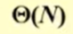,合并时间是O(N),总的时间是

为了使用指针来进行操作，并且能够弥补时间上的问题，我们采用左式堆(Leftist Heap)

- Order Property--the sane
- Structure Property--binary tree,but unbalanced

#### Definition:The null path length(Npl(x))

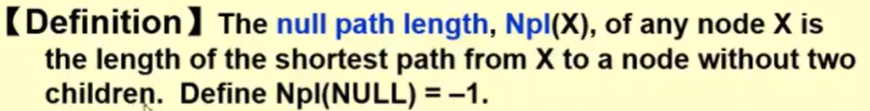

计算公式：

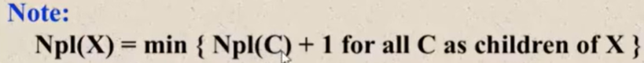

#### Definition:Leftist Heap

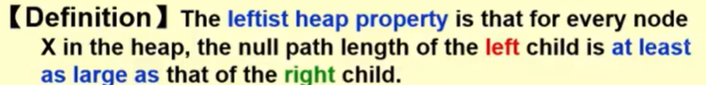

这个树是向左延申的

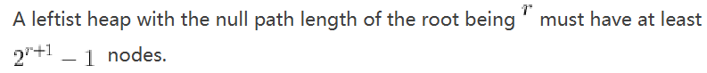

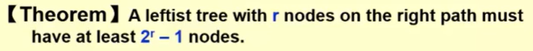

证明：

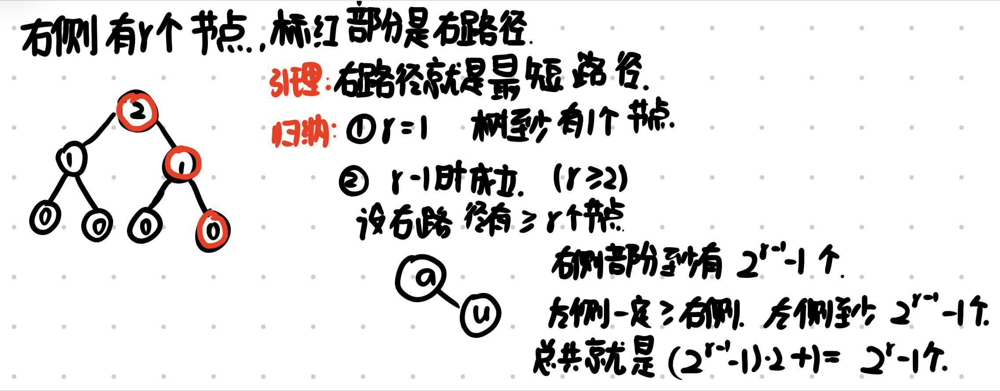

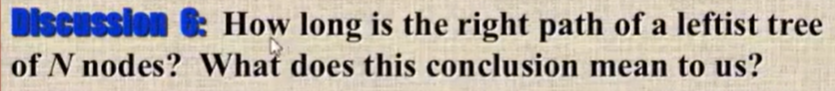

右侧路径是O(logN).所以我们希望所有的事情都可以do on the right path，这样时间会少一些

### Merge实现

#### Declaration

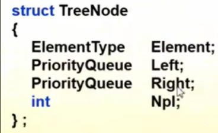

#### Merge

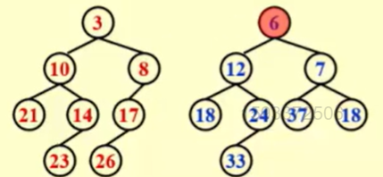

左侧的根比较小，所以最后的根也是3

1. Merge(H1->Right,H2)
2. Attach(H2,H1->Right)
递归形式：

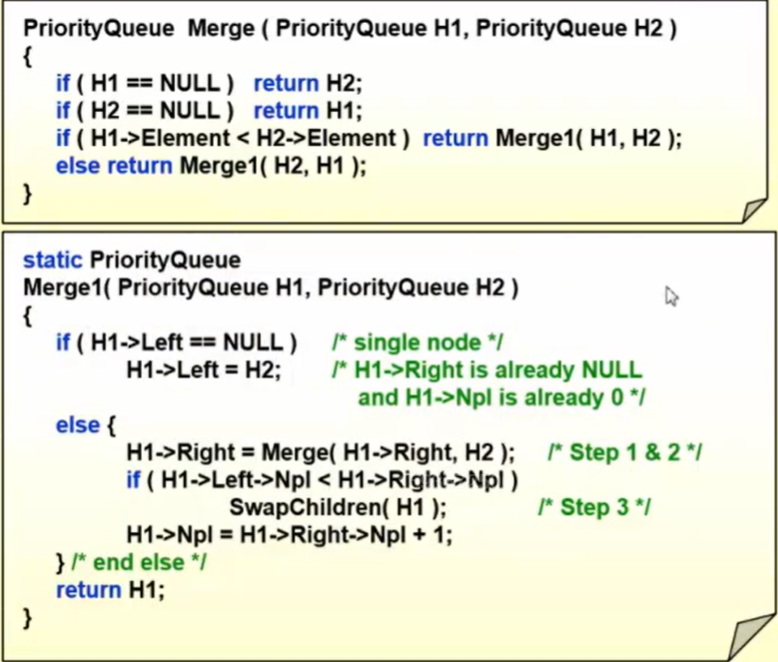

Merge处理最小的情况，注意更新NPL
> [!NOTE]
> 如果不对 Npl 进行调整，仍然是一个合法的最小堆，但是不再左倾，Swap 判断随之失真，右路径失去对数上界。

Time = O(logN)
循环形式：

1. Sort the right paths without changing their left children

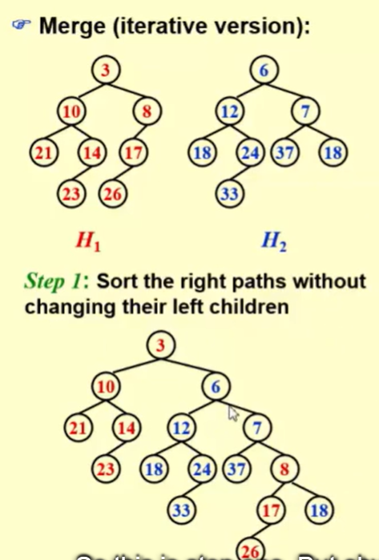

2. Swap children if necessary
(交换7和3的孩子)

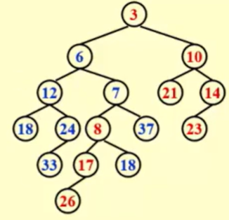

循环和递归是等价的

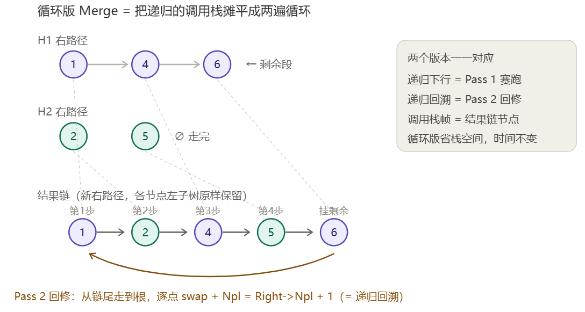

### Delete

去掉根节点之后就直接和合并两个树就可以了，时间是O(logN)

## Skew Trees  -- a simple version of the leftist heaps

### 目标

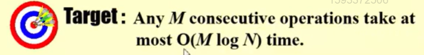

### 策略

### Merge实现

1. 保留较小的节点，将左子树变为右子树
2. 递归合并两个堆，递归流程和上面的一样

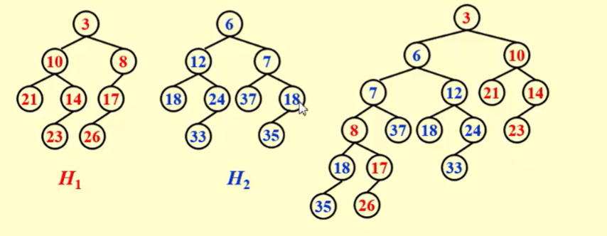

这是一个比较幸运的情况，结果是Leftist Tree，有的情况下不是

### Insert

就是两个树，一个是要插的那一个节点自己组成的树，剩下的就是要插的树

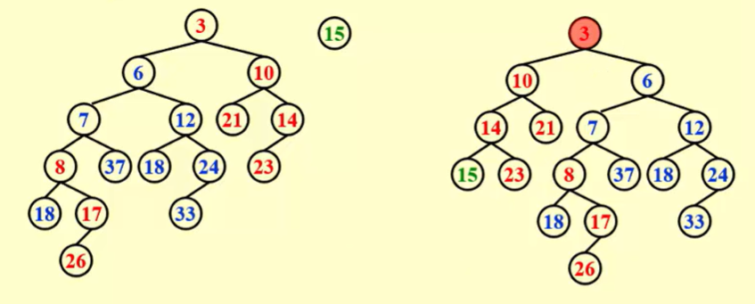

#### 优点

1. 不需要额外空间来维护空路径长度，不需要判断，直接换
2. 在Skew Trees中，摊还的右传长度一定，但是预期的不清楚

### Amortized Analysis for Skew Heaps

Insert&Deletion are just Merge

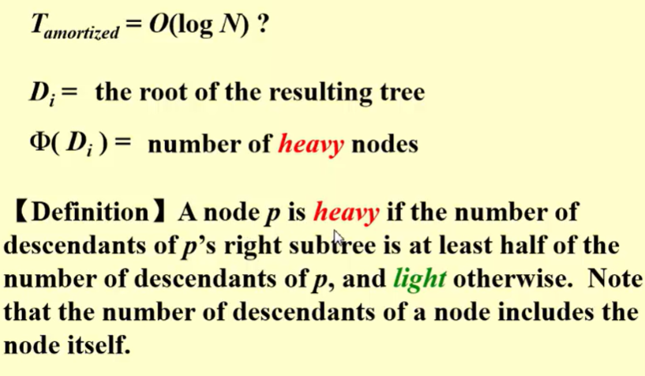

右子树的节点数至少是总数的一半或者一半多
示例说明：

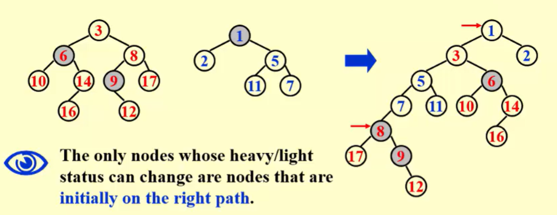

会发生改变的node是原来在右子树的Node

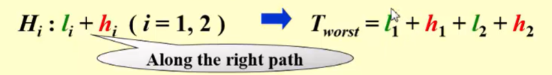

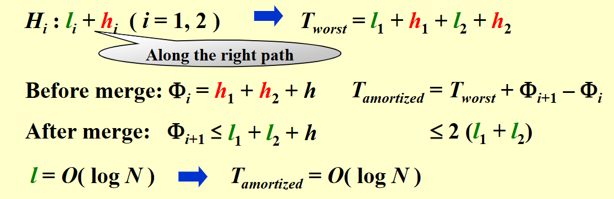

$H_i:l_i+h_i$这个表示的是右路径的长度
最坏时间复杂度(由于合并只沿着两棵树的右路径进行，因此最坏的情况就是把两个右路径走完)$T_{worst}=l_1+h_1+l_1+l_2$
势能函数Φ表示树中重节点的数量
合并前$Φ_i=h_1+h_2+h$
合并后$Φ_{i+1} \leq l_1+l_2+h$原来在右边的重节点都被换成轻节点了，原来是轻的现在可能是重的，也可能不是，所以最坏就是全变成这样了。
计算得到最后的结果。

## 题目

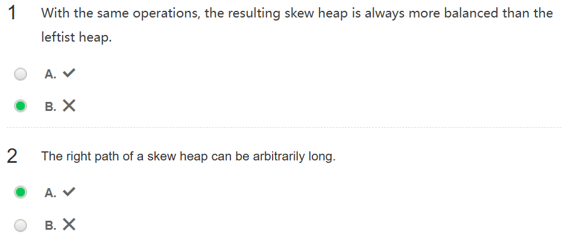

1. 在相同的操作序列下，得到的斜堆总是比左倾堆更平衡。
错误，因为它根本没有维护，所以最后的结果也不知道。

2. 斜堆的右路径可以任意长。
正确，因为它的结构是任意的

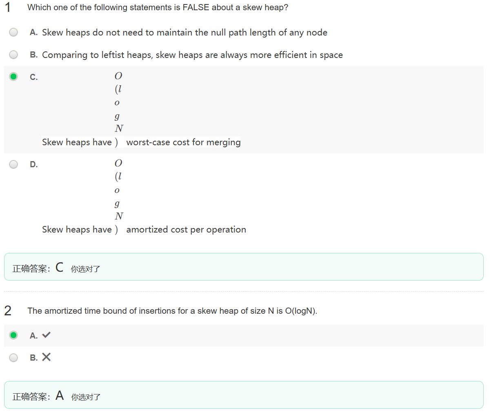

3. 与左倾堆相比，斜堆在空间上总是更高效(对的，因为斜堆不需要存npl，少存一个东西会好一点)
### 题目 4

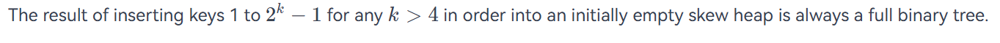

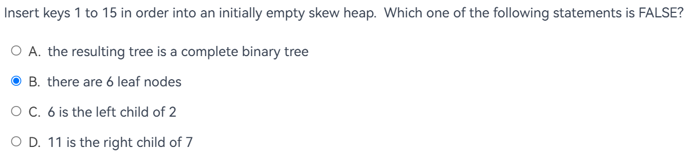

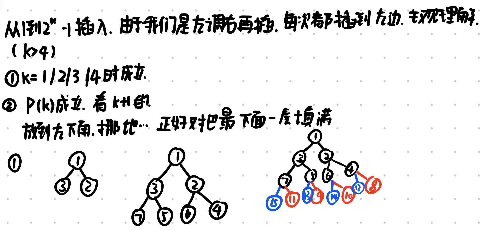

### 题目 5

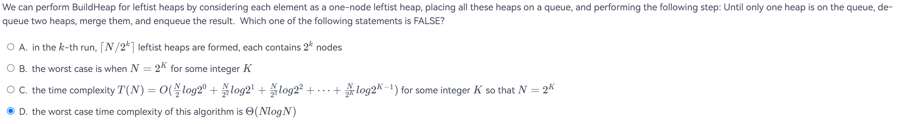

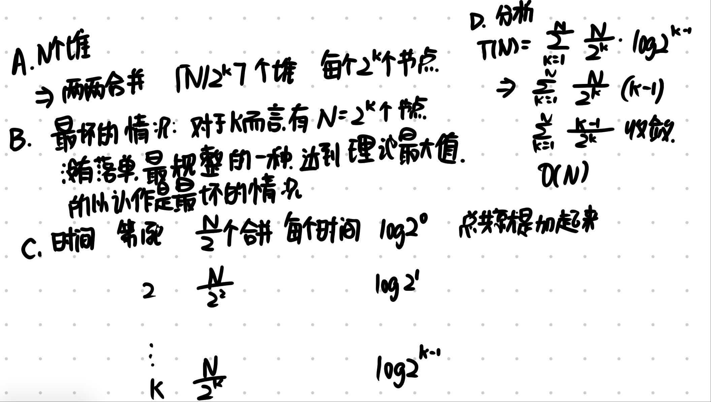

## 课程内容

交换的时候不改变parent的Npl，变化的时候变化最多是logN次，调整的时间是O(logN)

可以。我们采用拆开再合并的方式。

1. 将改变的节点p作为拆开后的一个树的根节点，将p下面的节点一起拆出作为一个树
2. 对剩下的节点进行调整，使其变成Leftist Heap.由于交换的时候不改变parent的Npl，变化的时候变化最多是logN次，所以调整的时间是O(logN)
3. 将两个拆分出的Leftist Heap合并，合并的时间是O(logN)
这样就实现了DecreaseKey operation，时间是O(logN)
