# Inverted File Index(倒排文件索引)

> [!NOTE]
> The real key technique used by search engines.

## Must-to-do to build a searching engine

### 1. Spider

Fetch those web pages from the Internet.

### 2. To retrieve web pages that we need

1. Scan each page for the need
2. Term-Document Incidence Matrix(词项-文档关联矩阵)

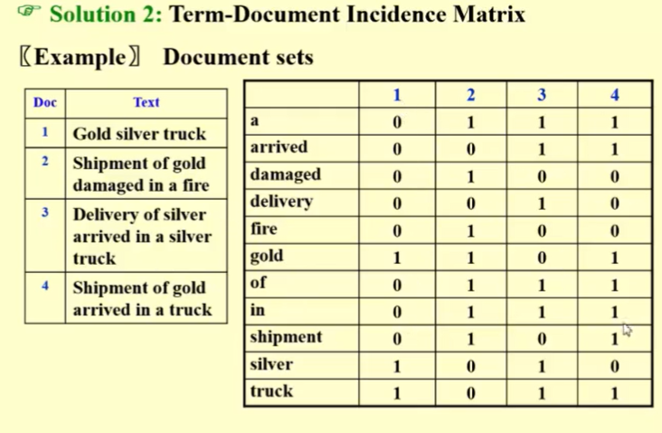

查找一个词，这个的查找速度是很快的，直接对照着词的那一行看哪个是1就可以了
如果想找一个短语，我们把这个短语里的所有词对应的01找出来进行&操作，为1的那一位对应的就是想要找的网页了

问题：这个矩阵可能是非常稀疏(sparse)的，很多0.浪费时间空间
提升：用链表来代替matrix

3. Compact Version-Inverted File Index

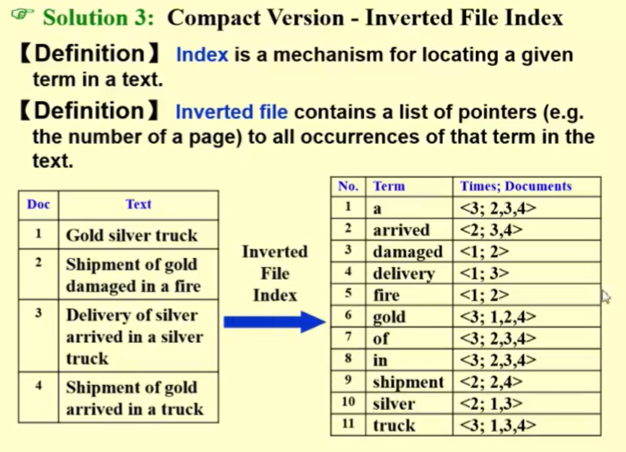

出现了几次，分别在哪几个出现的

#### Q1: How to easily print the sentences which contain the words and highlight the words?(生活中真实生活出现的情况)

A:为了完成目标对内容进行修改

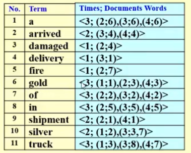

后面的内容从第几个网页变成了第几个网页的第几个词
如果一个里面出现了多次，就写成(3;3,7)表示第3个网页里面的第3个第7个词

#### Q2: Why do we keep this times or say,frequency?

A:保留词频是为了让倒排索引不仅能回答“哪些文档包含这个词”，还能回答“这些文档中这个词有多重要”，从而支持相关性排序、评分和更高级的检索功能。

为了实现以上内容提出的方法：

### Index Generator

先找到所有网页，再判断是否在dictionary里面，如果没有就再建一个放进去

1. 如何判断一个词是一个词
2. 查找，查找一个词在字典中
3. 将新的词插入到字典中
4. 数据过于庞大，需要新的内存去存储

## 读取单词

### Word Stemming

对于带后缀的词找词根

### Stop Words

过于常见的单词不需要再去记录，叫做stop words。我们可以把它们从原始文档中删除

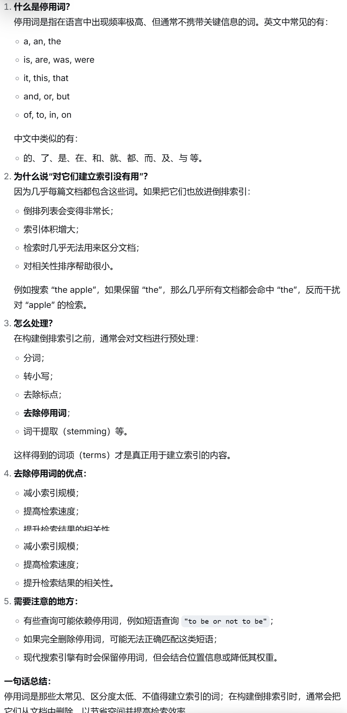

这些词不是直接全删掉，而是要看这个词的重要性再看情况是否要去

## Accessing a term（查找单词）

### Solution1:Search trees(B+ Trees,B- Trees)

### Hashing：faster for a single word but expensive for range search

优点：faster for one word
缺点：scanning in aequential order is not possible(对于范围搜索则代价高昂)
B+的话可以如果给出数错了之后再给出一个相似的。

### memory management

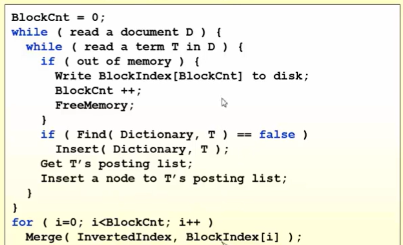

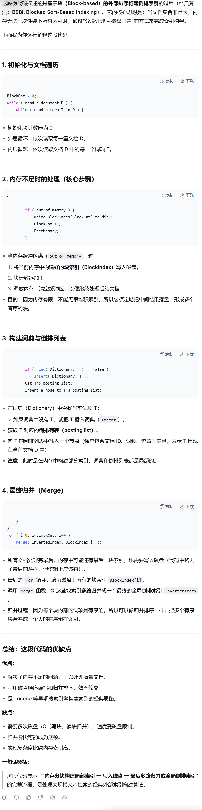

## Distributed indexing(分布式索引)

--Each node contains index of a `subset` of collection

- Solution 1:Term-partitioned index(词项分区索引)
- Solution 2:Document-partitioned index(文档分区索引)

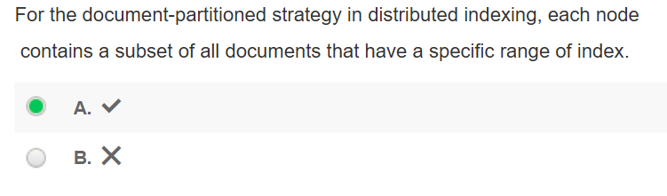

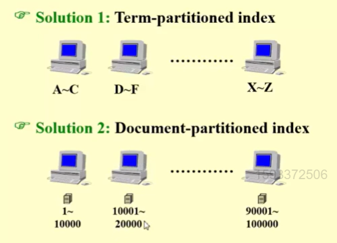

## Dynamic indexing(动态索引)

一直在更新删除，这样的话时间会很长

- Solution:在数据库中维护一个主索引(main index)，同时维护一个辅助索引的索引(auxiliary index)

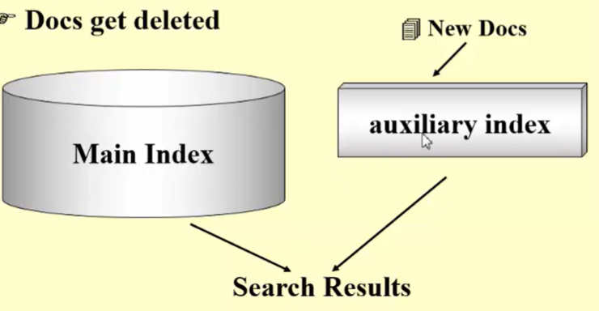

查找的时候两个一起找，插入的时候插入到辅助索引的里面，在必要的时候把辅助索引的东西全部放到主索引里面再清空

1. Q1：When to re-index ?
2. Q2:How to delete a doc ?

## Compression(存储)

1. 去掉stop words
2. 将所有单词存储在一条长字符串中
3. 另存一个数组存储每一次的开始的位置

记录的不再是第几个出现，而是第几个出现相邻之间的插值

- In posting list compression, posting lists are sorted ascending, we store differences instead of absolute values.  What problem can it cause and how would you solve it?
- 问题：1.随机查找能力差，想要访问一个文档需要从头开始加法计算它的位置，需要时间长。
2. 维修成本高。如果中间一个位置出现问题，导致后面在计算位置的时候全部都会出错。
3. 在我们需要往中间进行插入的时候，需要对后续的数据进行修改，数据进行移位(值不变，但是数据的位置换了也需要操作)。
解决方法：1.每隔固定的一段长度之后，在一个新的节点重建一个链表，记录新的绝对位置，接下来再在这个绝对位置的基础上进行差值位置储存。(跳表)

2. 根据词的查找频率来分配长度大小。频率较高长度较小，频率较低长度较大
- 往中间插入的原因：
插入的时候是按照字典序或者rank等往里加的。所以如果需要添加内容的话就需要往里面进行插入。

## Thresholding(阈值)

- Documents:将文档按权重排布，只取前几个

不适合布尔查询，截断可能会漏掉相关文档

- Query:将查询词项按其在文档中出现的频率升序排列；仅根据原始查询词项的一定百分比进行搜索。
升序：说明出现次数少的出现在前面，出现多说明很多文档都有，重要性就比较低。这种方法确实能完成调序

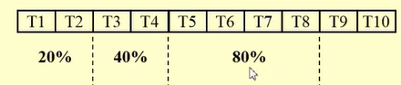根据实际情况调整阈值

## Measures for a search engine

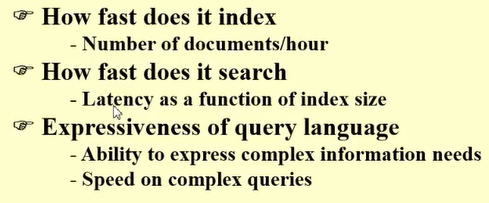

每小时处理的文件数，用户搜索之后得到结果的等待时间（包括延迟）。处理复杂语言查询，复杂指令的能力

用户满意度

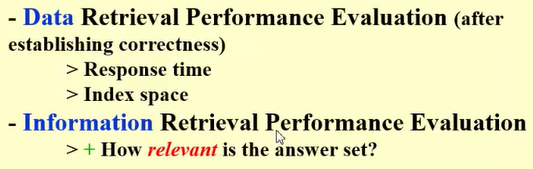

数据检索性能（原始数据，获取数据的能力和查询时间）、信息检索性能（从数据得到的结果，评价看相关性）

1. 基准文档集合：用于测试的标准化文档库。
2. 基准查询集：一组标准的测试查询语句。
3. 二元评估：对每个“查询-文档”组合，人工或自动标注其是否相关（Relevant / Irrelevant），作为评估检索系统效果的“标准答案”（ground truth）。

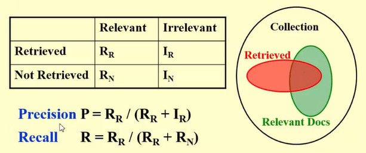

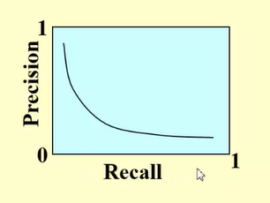

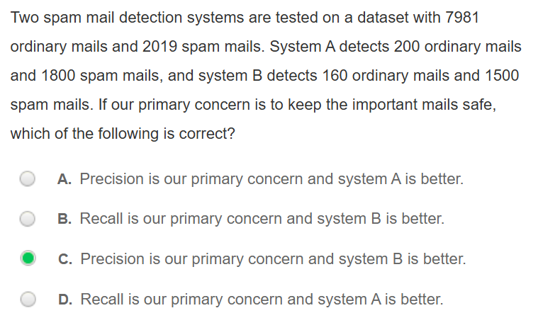

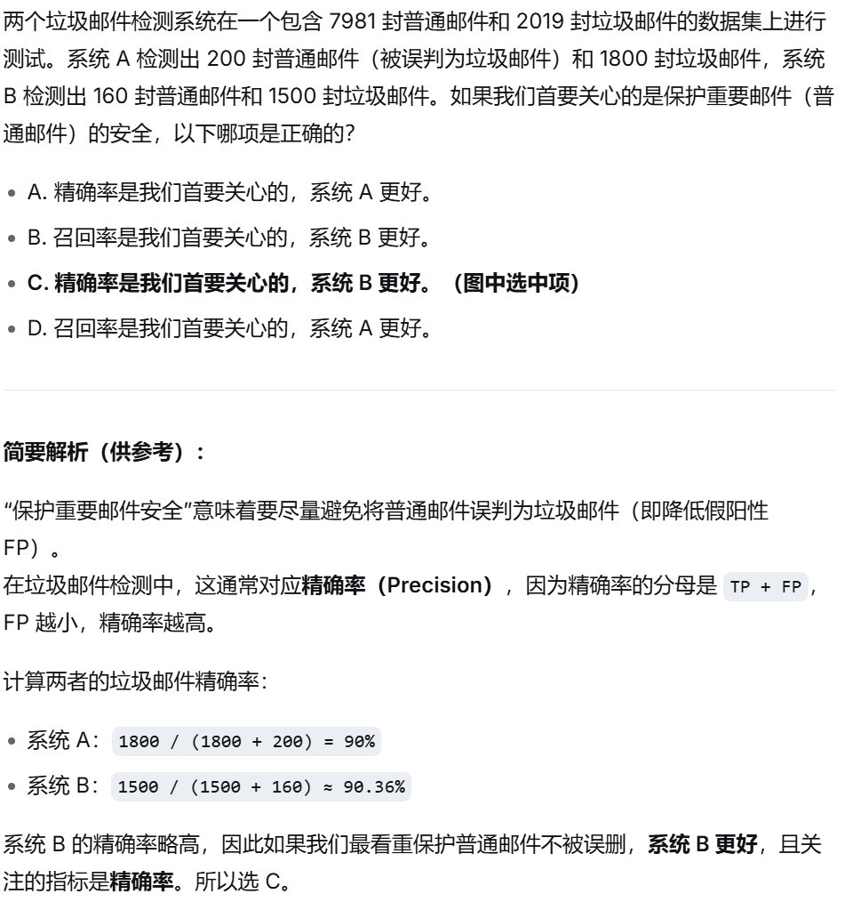

## 补充：

### 条目 1

FTP:文件传输协议。一种在网络上上传、下载文件的协议。
WWW:万维网。运行在互联网上的超文本信息系统。
WWWW:万维网漫游者。早期搜索引擎项目
Yahoo! 北大天网 搜狐 Google 百度

### 条目 2

Index:给出一个文件给出关键词
Inverted file index:根据关键词找到文件

precision:常用的词，垃圾邮件的删除(正确的邮件最好不要被删除)，不能误诊的医疗诊断
recall:比较小众一点的词，判案找证据，召回之前发行的出问题的汽车，监考系统

## 题目：

### 条目 1

F，term-partitioned是按照term顺序来加。

### 条目 2

在评估数据检索系统性能的时候，相关性是最核心的衡量标准。

### 条目 3

错误。翻译：在评估数据检索（或信息检索）的性能时，衡量答案集（即返回的结果集）的相关性是非常重要的。
数据检索（Data Retrieval）衡量的是精确性（Correctness）。信息检索（Information Retrieval）衡量的是相关性(Relevancy)
