# 算法与回溯

## Backtracking

### 暴力枚举

在有限个候选答案的情况下可以实现的

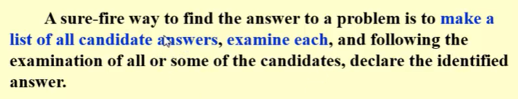

无限或极多个候选答案的时候较难实现

### Backtraking的方法(pruning剪枝)

> 基础想法

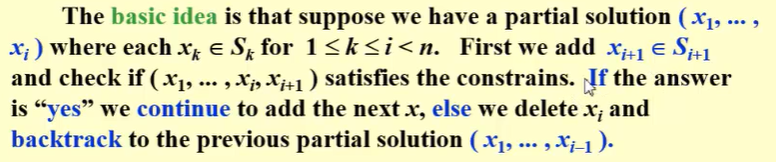

#### 示例：八皇后问题

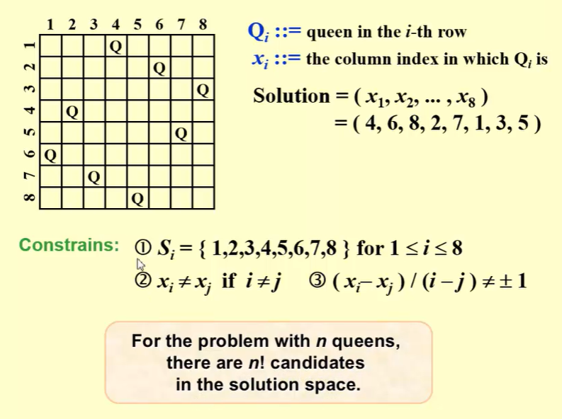

1. 列举gametree
2. DFS查找可能的结果，如果一条路径中有地方出错了，把错误的这个地方的节点删了，查找删除节点子节点的其他孩子节点。都不成立的话说明这一侧的都不对，再往后查找(加了这个节点出错的节点是我们需要删的节点)

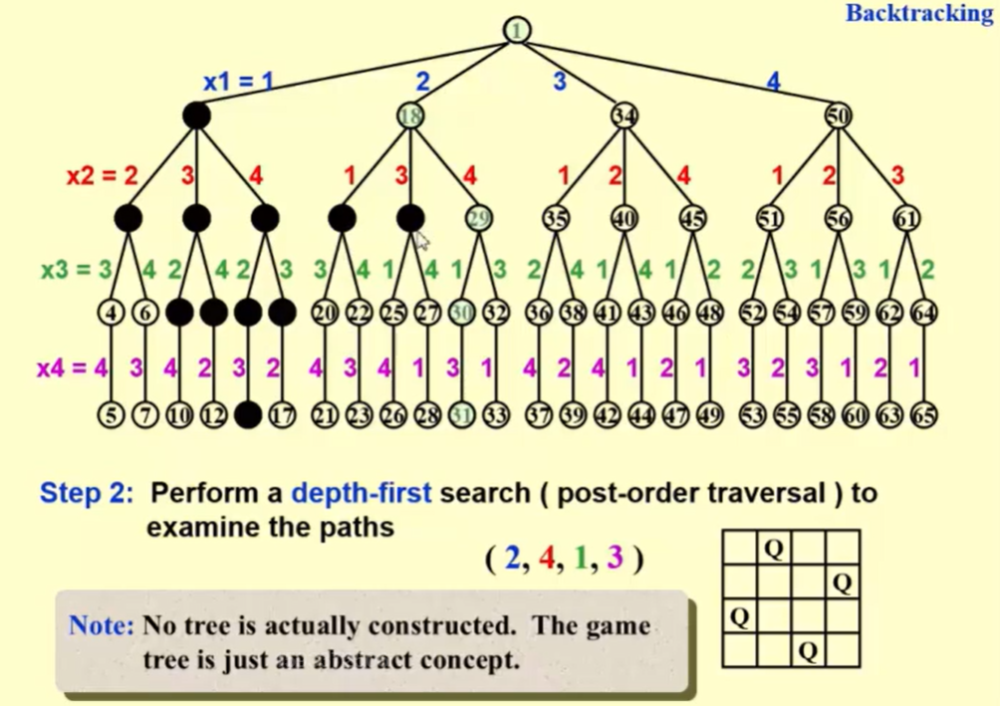

实际过程中是不建树的，这个操作的时间是和穷举操作相当的。

#### 示例:收费公路重建问题

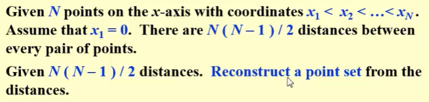

1. 找到节点总数
2. 第一个放在0，另一个放在最远的那个地方
3. 下面每次找最长的那个节点，讨论最长节点的位置，确定此时最长节点的位置之后将现在有的距离删掉，重复这样的操作，如果此时出错就回溯到上一步，然后判断错误节点的兄弟节点
注意此时的最长的位置也是从最远的那个或者最开始的0开始算的位置

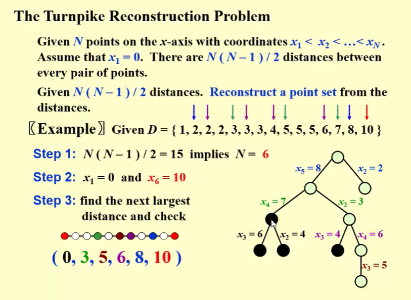

##### 代码实现

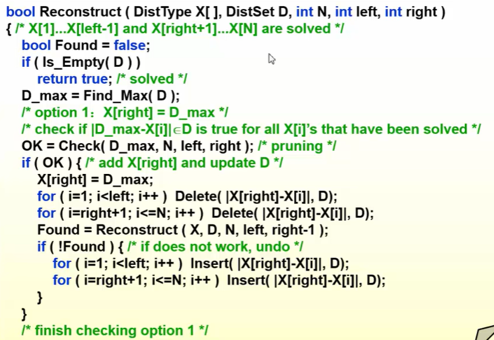

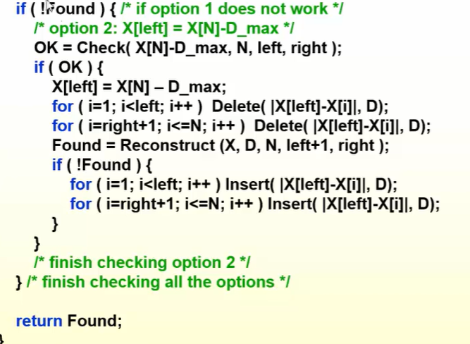

Backtracking的内容

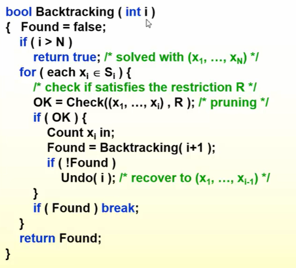

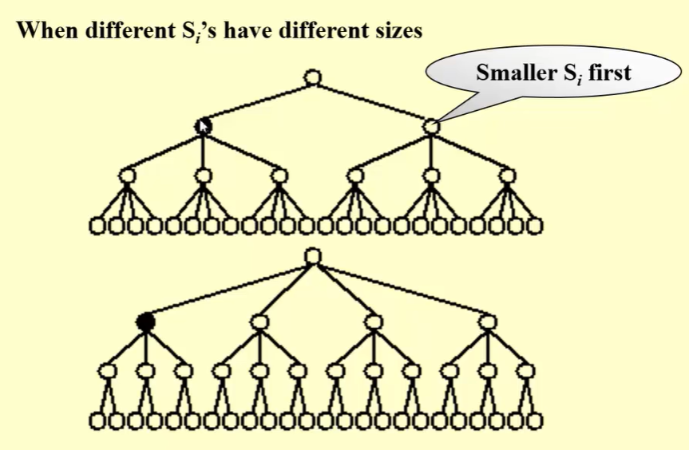

#### 示例:Games(AlphaGo)

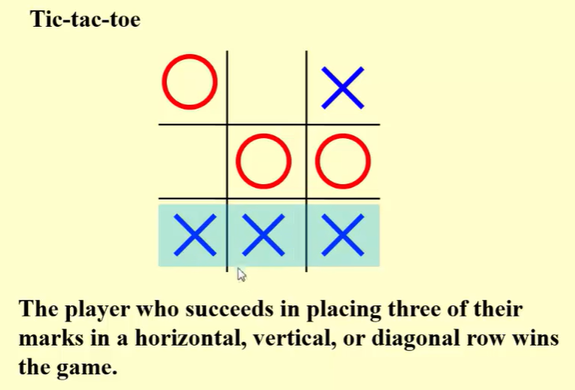

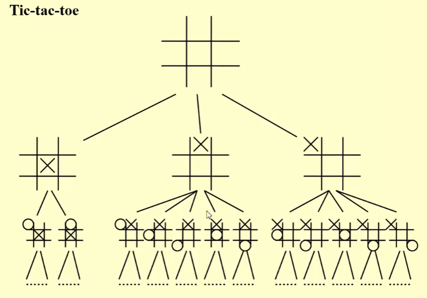

##### Minimax Strategy

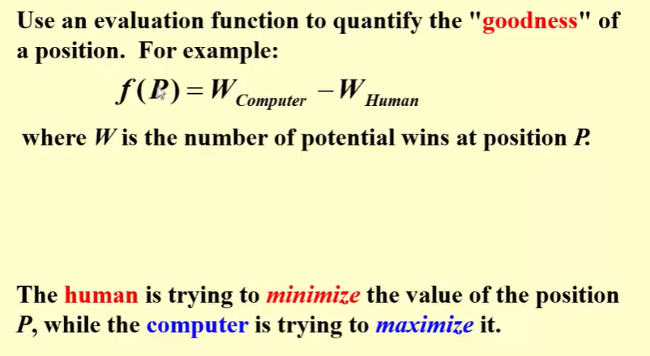

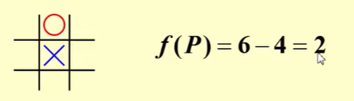

该人类的时候就选小的那个，该电脑的时候就选大的那个

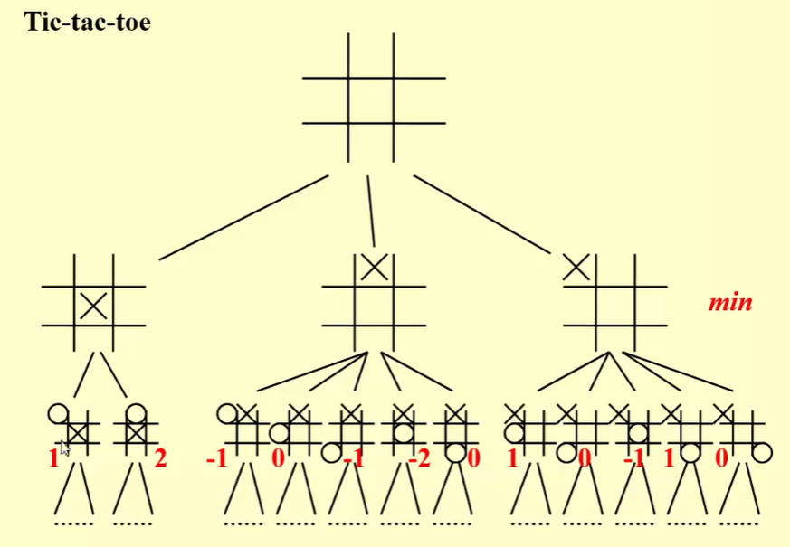

###### alpha剪枝

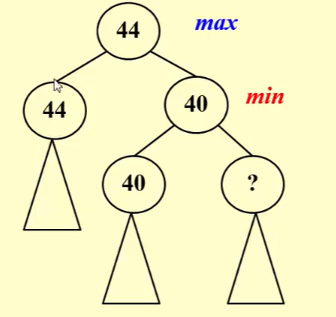

最小层的时候，较小树的不等于树的根节点的那个子树可以去掉了

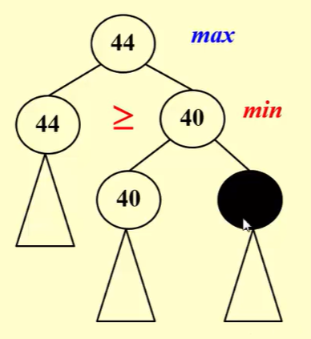

###### beta剪枝

最大层的时候，较大树的不等于树的根节点的那个子树可以去掉了

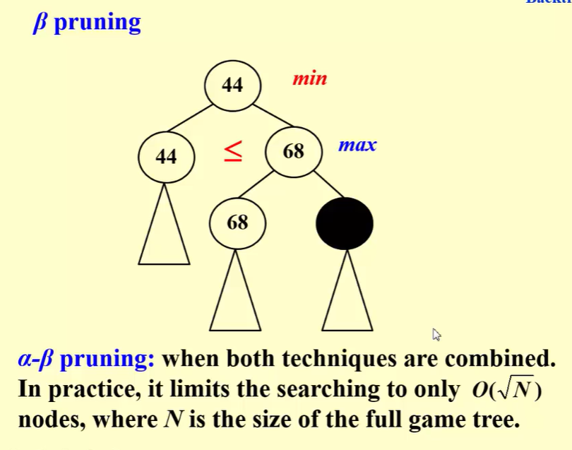

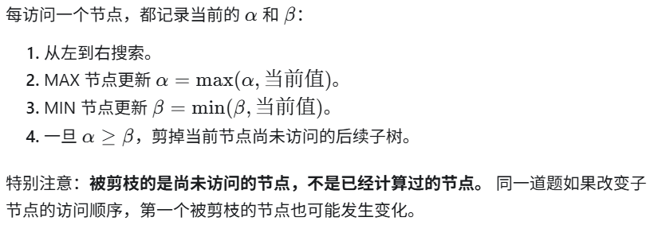

exhaustive search：暴力枚举

## 补充

接下来开始算法部分：Backtracking比较符合直觉

现在已知的点包含最长的距离的两个点0和L，取剩余距离中最大距离d一定也是在0到L之间的距离。新点只可能在d或者L-d两个位置，讨论或判断比较容易。
如果是随机取或者取最小距离，由于最小距离不一定是和两个端点之间的距离，可能是中间相邻的两个点之间的距离，所以不能像取最大距离那样直接有两个候选，分支和匹配更复杂。
