# Balanced Trees 2
## Red-Black Tree
1. 背景：为了加速搜索，保持搜索树的动态平衡
2. 定义：
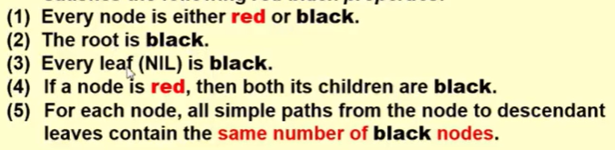
每一个点都是红的或黑的，根和空节点都是黑的，一个节点是红的，孩子全是黑的。对于每一个节点来说，从它出发到叶子节点黑节点的总数是一样的
这里把空节点看成是叶子节点，写的时候把NULL作为一个节点，所有空指针指到这里
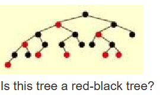
这是红黑树
- 红的下面一定是黑的，但黑的下面不一定是红的。判断的时候看从节点到叶子节点的黑色的节点的数量是否一致。
3. 重要概念：black-height
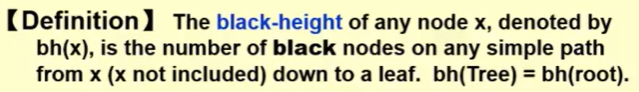不包括根的黑节点的数目(NIL是被计入黑高的)
其中bh(tree)=bh(root)
引理:N个节点的红黑树的高度最多是2ln(N+1)
证明：
- $sizeof(x) \geq 2^{bh(x)} -1$ 用递归来证明
x=0时成立，
h(x)=k时成立，有$sizeof(x) \geq 2^{bh(x)} -1$
h(x)=k+1时，bh(child)=bh(x)/bh(x)-1
$sizeof(child) \geq 2^{bh(child)} -1 \geq 2^{bh(x)-1} -1$
$sizeof(x)=1+sizeof(left)+sizeof(right) \geq 2^{bh(x)} -1$
- $bh(Tree) \geq h(Tree)/2$
4. 操作
- Insert：只要bh(root)不变，我们就不需要再进行下面的操作了（可以用循环来做）
每次插入的时候都是红的
Case1:红的父节点是红的，父节点的兄弟节点也是红的。`整体换`
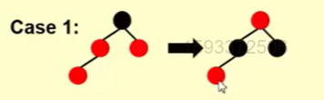
Case2:红的父节点是红的，父节点的兄弟节点不是红的。而且是之字型`左转`
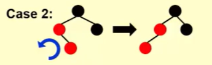
Case3:红的父节点是红的，父节点的兄弟节点不是红的。而且是一字型`和父节点换右转`
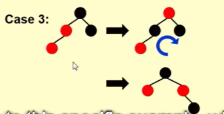
- Delete:这是红黑树比AVL树好的主要原因
删除AVL树的节点的时候最坏的情况可能是从下往上全部进行旋转，时间是O(logN)
但是红黑树最多三步旋转就行了
删除不是叶子节点的：移动的时候只动数字不动颜色
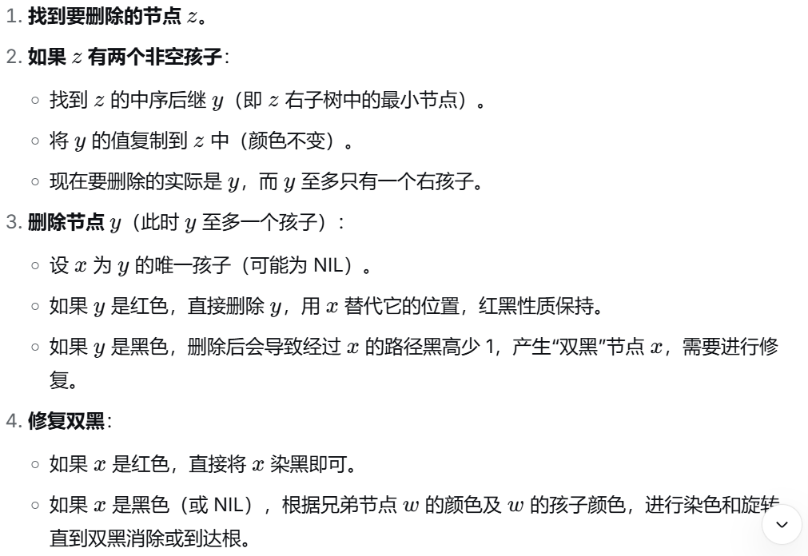


删除是叶子节点的：
Case1:一个红的兄弟节点和一个黑的父节点`和父节点换左转`
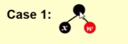
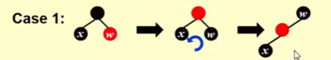
Case2-4:
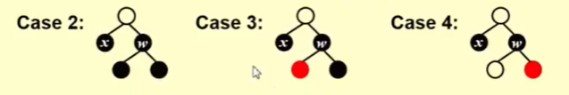x的兄弟节点是黑的
Case2:把兄弟节点变成红的
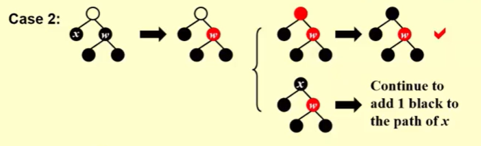
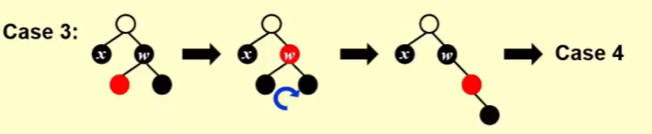
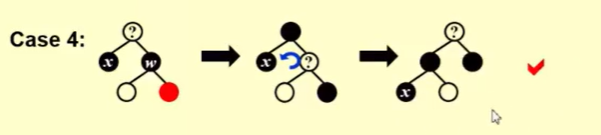

5. 补充

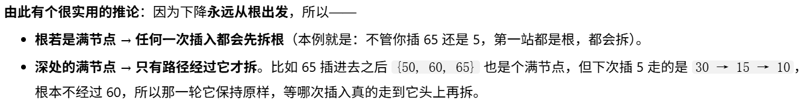
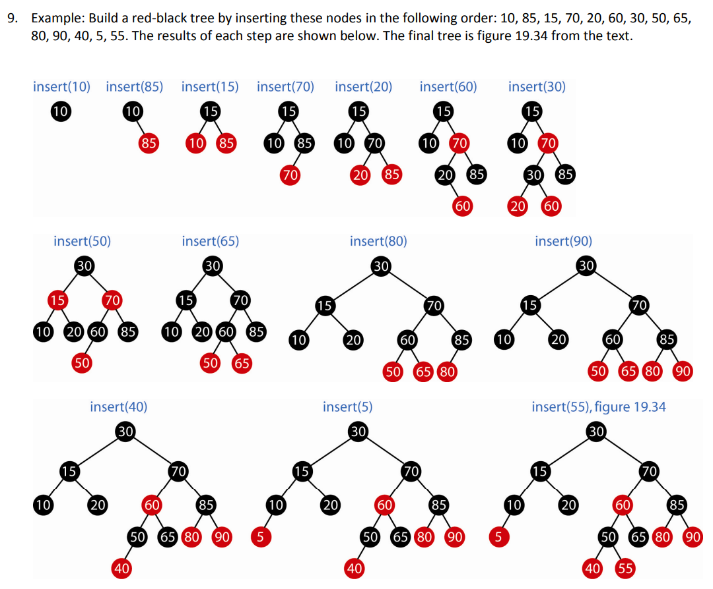

方法会有很多
一黑带两红就换一下，
## AVL Tree and Red-Black Tree
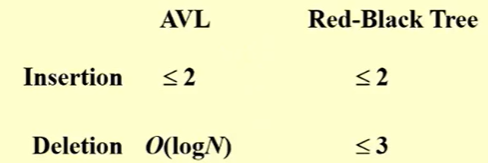
搜索:AVL Tree,单纯搜索AVL Tree更快
涉及到插入删除：Red-Black Tree
## B+ Trees
Search Tree but not binary Tree
1. 背景：存储
2. 定义：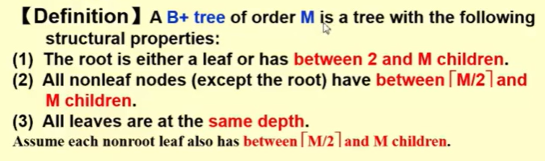
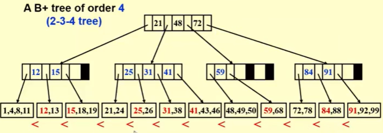
一个2-3树默认是B+树
- 从下往上开始建树
3. 建树
从下往上建树是找第二个区间里面最小的作为父节点中的一个。如果是order M，那么就会有M-1个空要填，没有的话就是空格。然后再往上一层的父节点是最底下一层的右孩子的第一个区间的最小的数，还是没有空格。
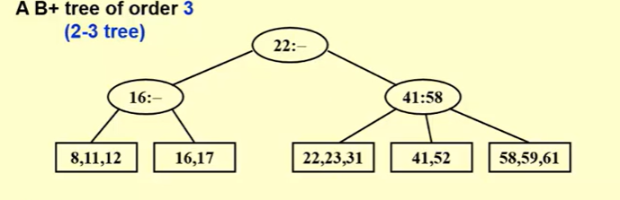
4. Find
还是通过比较来找在哪个分支的方法。最后找到区间用二分查找。一个节点里面数多了就用二分查找
5. Insert
通过比较找在哪个分支，进入分支之后进行二分查找找到前一个比他小，后一个比它大的插入。
如果要插入的分支满了，并且父节点还没满，就进行分裂。如果再父节点也满了就往上走再分裂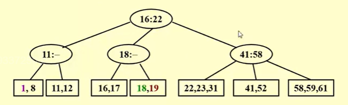
6. 代码
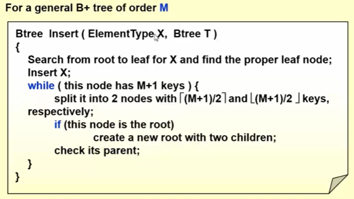
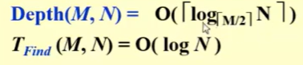
The best choice of M is 3 or 4.


练习题：
1. 
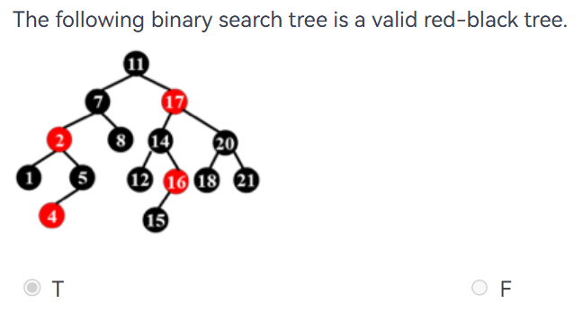
不是，16的左边黑高是1，右边的黑高是2.
2. 
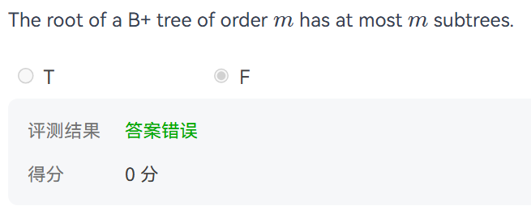
order m就是m个子树，最下面的最多有m个

3. 
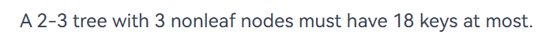
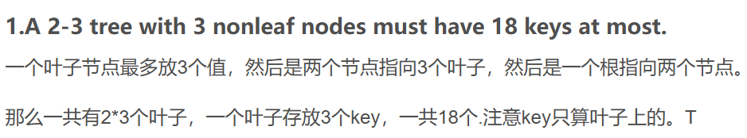

4. 
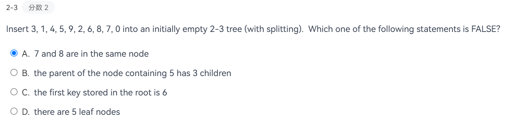
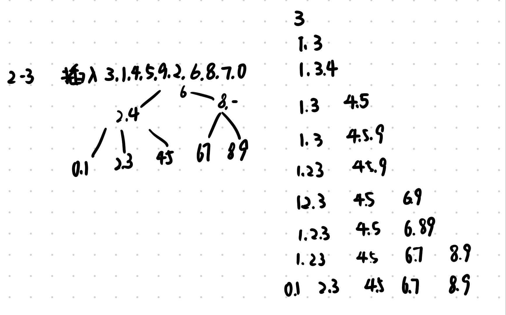

5. 
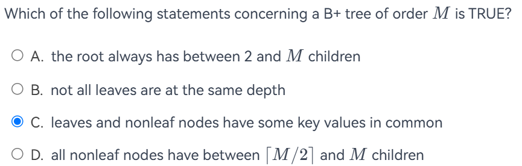
A.如果B+树只有一个节点，那么它没有孩子。对于非空并且非叶子的根，通常至少有两个孩子
B.所有的叶子节点都在同一层
C.正确
D.除了根以外的所有的非叶子节点都必须满足这个条件。如果是根的话可以只有两个孩子

6. 
F,红的下面颜色相同，都是黑的，黑的下面颜色可以不同

7. 
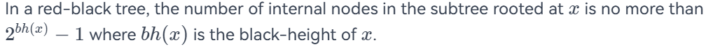
F，是要包括叶子节点(NULL)才满足条件

8. 
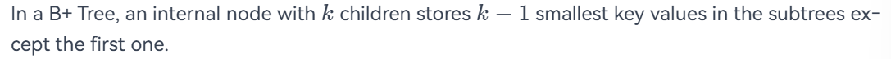
T，在B树中，一个有k个子节点的内部节点在除第一个子树以外的子树中存储k-1个最小的键值。说的就是每一个子树的最小的值。

9. 
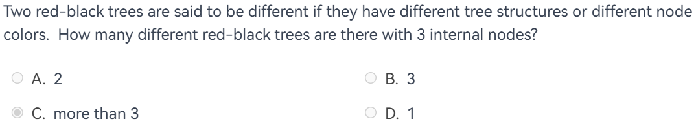
两个。
黑根，下面两个红
黑根，下面两个黑
如果想要两个都在左边的话，会出现红的下面连红的的情况，不成立。

10. 
The function FindKey is to check if a given key is in a B+ Tree with its root pointed by root. 
Return true if key is in the tree, or false if not. The B+ tree structure is defined as following:
```c
static int order = DEFAULT_ORDER;
typedef struct BpTreeNode BpTreeNode;
struct BpTreeNode {
    BpTreeNode** childrens;  /* Pointers to childrens. This field is not used by leaf nodes. */
    ElementType* keys;
    BpTreeNode* parent;
    bool isLeaf;  /* 1 if this node is a leaf, or 0 if not */
    int numKeys;  /* This field is used to keep track of the number of valid keys. 
    In an internal node, the number of valid pointers is always numKeys + 1. */
};


bool FindKey(BpTreeNode * const root, ElementType key){
    if (root == NULL) {
            return false;
    }
    int i = 0;
    BpTreeNode * node = root;
    while (!node->isleaf) {
        i = 0;
        while (i < node->numKeys) {
            if (key>=node->keys[i]) i++;   //keys也是一个链表来的，也是要比较不同位置的
            else break;
        }
        node = node->childrens[i];
    }
    for(i = 0; i < node->numKeys; i++){
        if(node->keys[i] == key)
            return true;
    }
    return false;
}
```